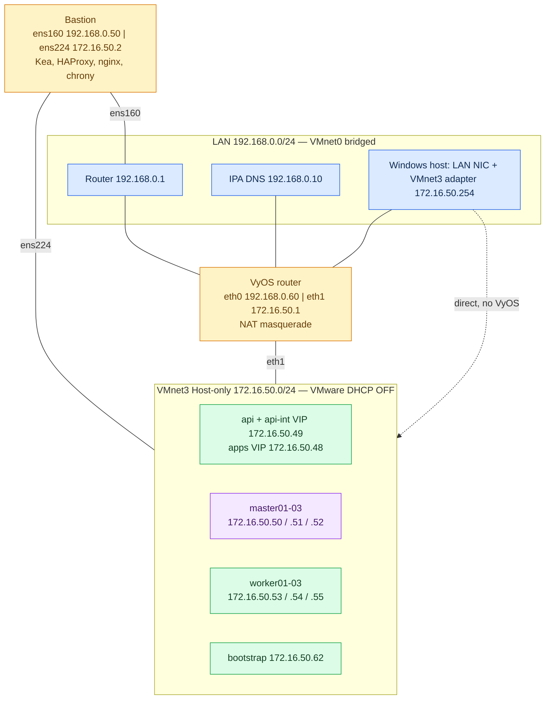

# OpenShift 4.22 on VMware Workstation — rebuilt UPI guide (v2)

**Revision:** 11 October 2026  
**Cluster:** `ocp.openhelp.net` (3 masters + 3 workers + temporary bootstrap)  
**Machine network:** `172.16.50.0/24` on **VMnet3** (Host-only, VMware DHCP off)  
**Router:** VyOS (`eth0` LAN `192.168.0.60`, `eth1` VMnet3 `172.16.50.1`)  
**Bastion:** `ens160` LAN `192.168.0.50`, `ens224` VMnet3 `172.16.50.2`  
**DNS:** existing IPA `192.168.0.10`  
**Method:** manual UPI from the RHCOS live ISO, Kea DHCP reservations, HAProxy, nginx for Ignition

> [!IMPORTANT]
> I cannot run your VMware lab, so I cannot tell you which step of the old guide failed for you. Part 0 lists the defects I found by reading it. This guide is built around **verification gates**: after each phase you run a few commands and compare them with the expected result. **Do not continue past a gate that does not match.** If a gate fails and you cannot fix it, send me the command and its output and I can pinpoint the cause.

## Contents

- [Part 0 — What was wrong in the old guide](#part-0--what-was-wrong-in-the-old-guide)
- [Part 1 — Architecture and address plan](#part-1--architecture-and-address-plan)
- [Part 2 — Capacity and prerequisites](#part-2--capacity-and-prerequisites)
- [Phase 1 — VMware and Windows (steps 1–4)](#phase-1--vmware-and-windows)
- [Phase 2 — VyOS (steps 5–7)](#phase-2--vyos)
- [Phase 3 — Bastion OS and network (steps 8–11)](#phase-3--bastion-os-and-network)
- [Phase 4 — DNS on IPA (steps 12–14)](#phase-4--dns-on-ipa)
- [Phase 5 — Bastion services: Kea, HAProxy, nginx (steps 15–19)](#phase-5--bastion-services)
- [Phase 6 — Installer assets (steps 20–25)](#phase-6--installer-assets)
- [Phase 7 — Install the nodes (steps 26–29)](#phase-7--install-the-nodes)
- [Phase 8 — Finish the cluster (steps 30–37)](#phase-8--finish-the-cluster)
- [Appendix A — Troubleshooting matrix](#appendix-a--troubleshooting-matrix)
- [Appendix B — Hostname fallback (Ignition wrapper)](#appendix-b--hostname-fallback)
- [Appendix C — Optional VyOS firewall](#appendix-c--optional-vyos-firewall)
- [Appendix D — Reaching the cluster from other LAN machines](#appendix-d--other-lan-machines)
- [Appendix E — Start, stop and starting over](#appendix-e--start-stop-and-starting-over)
- [Appendix F — Scope and references](#appendix-f--scope-and-references)

---

## Part 0 — What was wrong in the old guide

I read all 100 steps of `OPENSHIFT_4_22_VMWARE_UPI_OPENHELP_COMPLETE_UPDATED.md`. The hostnames, subnets, MACs, IPA DNS, Kea, VyOS, HAProxy and the 3+3 node layout are reasonable and are kept. These are the problems I found.

| # | Old step | Finding | Why it breaks | Fix in this guide |
|---|---|---|---|---|
| F1 | 15, 18A, 24, 26 | Commands use NetworkManager profile names `ocp-helper` and `ocp-private`, but the guide only says to "edit the existing profiles" in `nmtui`. Those names exist only if you renamed the profiles. | `nmcli connection modify ocp-private ...` fails. `ens224` then never gets its aliases, `never-default`, or firewall zone, and Kea or HAProxy cannot bind. | Step 8 finds the profile **by device** and renames it explicitly. |
| F2 | 6, 13, 24–27 | API `192.168.0.49` and ingress `192.168.0.48` are extra IPs on the bastion's **LAN** NIC. Your screenshot shows VMnet0 bridged to **Wi-Fi**. Wi-Fi bridging in Workstation is commonly reported to carry only a VM's primary MAC/IP, so extra addresses are often unreachable from the LAN. The bastion is also dual-homed, so LAN-sourced traffic to a private VIP gets replies on the other interface (strict `rp_filter` drops it). | Intermittent or total failure of API/console access, and a race between the two paths. | **All cluster endpoints live only on `172.16.50.0/24`.** Windows reaches them directly through its VMnet3 adapter. |
| F3 | 18, 41, 43 | Time depends on IPA acting as an NTP **server** for the nodes through NAT. That works only if IPA's chrony has an `allow` line for the clients and UDP 123 is open, which is not guaranteed. | Nodes never sync. Symptoms appear later as certificate-validity errors or CSR trouble after a pause. | The **bastion is the NTP server** for VMnet3 (step 10). |
| F4 | 43, 44, 57–63 | Seven hand-built Ignition "wrapper" files with nested SHA-512 hashes, a hard-coded `ignition.version 3.4.0`, and worker JSON that **wipes `/dev/sdb`** at first boot. | One wrong hash, version, or disk name means first boot fails. It also ties the base install to the optional HPP storage disk. | Serve the installer's three role files directly, as Red Hat documents. Wrappers are only a fallback (Appendix B). |
| F5 | 48–55 | Seven manual `nmcli` keyfile profiles with a `NODE_NIC` placeholder, plus `--copy-network`. | Unnecessary: Kea reservations already deliver IP, gateway and DNS to RHCOS's default DHCP. A typo creates a second competing profile. | No manual node networking. You only **verify** what DHCP delivered. |
| F6 | 18A | 4-hour leases with reservations only. `interfaces: ens224` while `ens224` also holds `.48`/`.49`, so the DHCP server identifier can be ambiguous. | If Kea or the bastion is down for more than 4 hours, nodes lose their addresses. | 7-day leases. A packet-capture gate shows the server identifier is `172.16.50.2`. |
| F7 | 6, 7 | VMware creates the Windows VMnet3 adapter as `172.16.50.1`, the same address as VyOS. The old guide mentioned this but never re-checked it. Editing the Virtual Network Editor again can reset it. | Duplicate gateway IP. The gateway intermittently answers from the wrong MAC. | Step 3 sets `.254` and the gate is repeated before node installation. |
| F8 | whole guide | Base install, virtualization, HPP storage, IPA wildcard certificates and disconnected mirroring are mixed into one sequence. | A failure in an optional part looks like "the install does not work". | This guide covers the **base cluster only** (see Appendix F). |
| F9 | 3, 32 | `SELECTED_OCP_VERSION` placeholders and manual file transfers from Windows. | Extra manual steps, and a wrong or mismatched installer/client/ISO. | The bastion has Internet through `ens160`, so it downloads from the official mirror and verifies SHA-256 (step 21). |
| F10 | 20 | Old A records for nodes at `192.168.0.5x` may still exist in IPA. `dnsrecord-add` then **adds** the new address beside the old one, so round-robin DNS returns both. | Random failures: half of the lookups return an unreachable address. | Step 12 removes old cluster records first, and the gate requires **exactly one** answer. |

---

## Part 1 — Architecture and address plan



### Address plan

| Machine / service | Interface / network | Address | Gateway | How assigned |
|---|---|---|---|---|
| Router | LAN | `192.168.0.1` | n/a | existing |
| IPA (DNS) | LAN | `192.168.0.10` | n/a | existing |
| VyOS upstream | `eth0` / VMnet0 | `192.168.0.60/24` | `192.168.0.1` | static |
| VyOS inside | `eth1` / VMnet3 | `172.16.50.1/24` | none | static |
| Bastion LAN | `ens160` / VMnet0 | `192.168.0.50/24` | `192.168.0.1` | static |
| Bastion private | `ens224` / VMnet3 | `172.16.50.2/24` | **none** | static |
| Ingress VIP (`*.apps`) | alias on `ens224` | `172.16.50.48/24` | n/a | alias |
| API + API-int VIP | alias on `ens224` | `172.16.50.49/24` | n/a | alias |
| Bootstrap | VMnet3 | `172.16.50.62` | `172.16.50.1` | Kea reservation |
| master01 / 02 / 03 | VMnet3 | `172.16.50.50` / `.51` / `.52` | `172.16.50.1` | Kea reservation |
| worker01 / 02 / 03 | VMnet3 | `172.16.50.53` / `.54` / `.55` | `172.16.50.1` | Kea reservation |
| Windows VMnet3 adapter | VMnet3 | `172.16.50.254/24` | none | static |

| Name | Resolves to |
|---|---|
| `api.ocp.openhelp.net` | `172.16.50.49` |
| `api-int.ocp.openhelp.net` | `172.16.50.49` |
| `*.apps.ocp.openhelp.net` | `172.16.50.48` |
| `helper.ocp.openhelp.net` | `192.168.0.50` |
| `helper-int.ocp.openhelp.net` | `172.16.50.2` |
| `bootstrap`, `master01-03`, `worker01-03` `.ocp.openhelp.net` | the node addresses above |

OpenShift networks: pod `10.128.0.0/14` (host prefix 23), service `172.30.0.0/16`. Neither overlaps `192.168.0.0/24` or `172.16.50.0/24`.

> [!NOTE]
> **Intentional change from the old guide:** the API and ingress moved from `192.168.0.49`/`.48` to `172.16.50.49`/`.48` (same last octets). This removes finding F2. The Windows laptop reaches them directly through its VMnet3 adapter. Other LAN machines cannot reach them without extra routing (Appendix D).

### Design rules (the reasons behind the steps)

1. **One DHCP server on VMnet3.** Kea on the bastion `ens224`. VMware DHCP is off and VyOS runs no DHCP or relay.
2. **VyOS is the node default gateway** (`172.16.50.1`) and masquerades node traffic out of `eth0`. The bastion never forwards or NATs.
3. **Nodes talk to the bastion and each other directly on VMnet3.** Only DNS (IPA), registries and Internet traffic cross VyOS.
4. **The bastion has one default route**, on `ens160`. `ens224` has no gateway.
5. **No manual node networking.** DHCP reservations deliver address, gateway, DNS, hostname and NTP.
6. **Every phase ends with a gate.**

---

## Part 2 — Capacity and prerequisites

| VM | vCPU | RAM | Disk | NIC |
|---|---:|---:|---:|---|
| master01–03 | 4 | 16 GB | 120 GB | 1 × VMnet3 |
| worker01–03 | 2 (4 preferred) | 8 GB (16 preferred) | 120 GB | 1 × VMnet3 |
| bootstrap (temporary) | 4 | 16 GB | 120 GB | 1 × VMnet3 |
| bastion | 2 | 4 GB | 60 GB | VMnet0 + VMnet3 |
| VyOS | 2 | 2 GB | 16 GB | VMnet0 + VMnet3 |
| IPA | existing | existing | existing | existing |

- The Red Hat minimums for the seven RHCOS machines add up to **88 GB RAM** (48 + 24 + 16). Add the bastion, VyOS, IPA and Windows. Do not lower the master or bootstrap RAM below 16 GB. etcd and the installer are the first things to fail under memory pressure.
- Use SSD/NVMe storage. etcd is sensitive to disk latency.
- You need a Red Hat account for the pull secret (free developer/trial) from <https://console.redhat.com/openshift/downloads>.
- The bastion needs Internet through `ens160`. The nodes need Internet through VyOS to pull release images from `quay.io` and `registry.redhat.io`.
- Install within **24 hours** of generating the Ignition files (step 25). The bootstrap certificates expire after 24 hours.

> [!CAUTION]
> RHCOS installation **erases the target disk**. Only run `coreos-installer` inside the new, empty VMs listed here, never on a VM that holds data (old OpenStack/Ceph nodes).

---

## Phase 1 — VMware and Windows

### Step 1 — Stop the old attempt

**Windows.** Power off any VM from the old attempt that owns `172.16.50.50–55`, `.62`, or `192.168.0.50–55`. Keep IPA, VyOS and the bastion. Keep the old install directory and backups; this guide uses a **new** directory (`cluster-v2`).

**Gate 1:** no old cluster VM is running.

### Step 2 — Configure VMnet0 and VMnet3

**Windows → VMware Workstation → Edit → Virtual Network Editor → Change Settings.**

| Network | Type | Subnet / mask | DHCP | Host adapter |
|---|---|---|---|---|
| VMnet0 | Bridged to the **named** physical adapter (not "Automatic") | existing `192.168.0.0/24` | home router's | physical NIC |
| VMnet3 | **Host-only** | `172.16.50.0` / `255.255.255.0` | **Use local DHCP service: unchecked** | **Connect a host virtual adapter: checked** |

Set every VM NIC to **Custom: Specific virtual network** and pick `VMnet3` or `VMnet0`. The generic "Host-only" choice can silently select VMnet1.

> [!WARNING]
> VMnet0 bridged to **Wi-Fi** works for VyOS and the bastion because each uses one address on that LAN. It does not reliably carry extra IPs (finding F2), which is why this guide puts no extra IPs on VMnet0. If VyOS later cannot reach `192.168.0.1` or `192.168.0.10`, try a wired adapter, or see the Wi-Fi note in Appendix A.

### Step 3 — Set the Windows VMnet3 adapter to 172.16.50.254

**Windows, PowerShell as Administrator.** VMware usually gives this adapter `172.16.50.1`, which is VyOS's address.

```powershell
Get-NetIPAddress -InterfaceAlias 'VMware Network Adapter VMnet3' -AddressFamily IPv4 | Format-Table IPAddress,PrefixLength
```

If it shows `172.16.50.1`, replace it:

```powershell
Remove-NetIPAddress -InterfaceAlias 'VMware Network Adapter VMnet3' -IPAddress 172.16.50.1 -Confirm:$false
New-NetIPAddress -InterfaceAlias 'VMware Network Adapter VMnet3' -IPAddress 172.16.50.254 -PrefixLength 24
Set-DnsClientServerAddress -InterfaceAlias 'VMware Network Adapter VMnet3' -ResetServerAddresses
Get-NetIPAddress -InterfaceAlias 'VMware Network Adapter VMnet3' -AddressFamily IPv4 | Format-Table IPAddress,PrefixLength
```

**Gate 3 (expected):**

```text
IPAddress     PrefixLength
---------     ------------
172.16.50.254           24
```

There must be **no gateway and no DNS** on this adapter. Re-run this check any time you change the Virtual Network Editor, restart VMware services, or after a Windows update, because VMware can reset the adapter to `.1`.

### Step 4 — Create the VMs and record every MAC

**Windows.** Create these VMs with the sizes in Part 2. Use **one** 120 GB disk each (SCSI default is fine), a **single** NIC set to `Custom: VMnet3`, no second disk, and the same firmware type (BIOS or UEFI without Secure Boot) for all seven RHCOS machines. Attach no ISO yet.

| VM | NIC MAC (from your old configuration) | Reserved IP |
|---|---|---|
| bootstrap | `00:0c:29:33:60:60` | `172.16.50.62` |
| master01 | `00:50:56:38:15:01` | `172.16.50.50` |
| master02 | `00:50:56:35:f8:e7` | `172.16.50.51` |
| master03 | `00:50:56:2e:3f:53` | `172.16.50.52` |
| worker01 | `00:50:56:36:09:EC` | `172.16.50.53` |
| worker02 | `00:50:56:20:25:48` | `172.16.50.54` |
| worker03 | **read it, it was never supplied** | `172.16.50.55` |

To set or read a MAC: **VM Settings → Network Adapter → Advanced → MAC Address**. Workstation accepts manual MACs in `00:50:56:00:00:00–00:50:56:3F:FF:FF`. All of the supplied `00:50:56:…` values fit. Alternatively, read the `.vmx` file (VM powered off):

```powershell
Select-String -Path 'D:\VMs\worker03\worker03.vmx' -Pattern '^ethernet0\.(address|generatedAddress|addressType) '
```

(Use your real VM path.) `ethernet0.address` is a manual MAC; `ethernet0.generatedAddress` is an automatic one.

Also give the **bastion** two NICs (`VMnet0` first, `VMnet3` second) and **VyOS** two NICs (`VMnet0` first, `VMnet3` second). Record the MACs of both NICs of each.

**Gate 4:** every MAC in the table is confirmed against VMware, **including worker03**. If any VM has a different MAC now, use the real one in Kea (step 15). Write them down; Kea has no pool, so an unknown MAC gets no address.

---

## Phase 2 — VyOS

> [!NOTE]
> Commands work on VyOS 1.4, 1.5 and the current Stream/rolling releases. If a command is rejected, press `?` or Tab after the last word. Syntax differs between major versions.

### Step 5 — Identify the interfaces

**VyOS console.**

```text
show version
show interfaces
```

Compare each `eth` MAC with VMware. **`eth0` must be the VMnet0 (LAN) NIC and `eth1` the VMnet3 NIC.** If they are swapped, fix the NIC order in VMware settings. Do not guess.

Check the existing configuration for leftovers from the old attempt:

```text
show configuration commands | match "eth|nat|route|name-server"
```

If `eth1` has an address other than `172.16.50.1/24`, or you see an obsolete NAT rule number you plan to reuse, remove it first, for example `delete interfaces ethernet eth1 address '<old>'`.

### Step 6 — Addresses, default route and NAT

```text
configure
set interfaces ethernet eth0 description 'LAN-VMnet0'
set interfaces ethernet eth0 address '192.168.0.60/24'
set interfaces ethernet eth1 description 'OCP-VMnet3'
set interfaces ethernet eth1 address '172.16.50.1/24'
set protocols static route 0.0.0.0/0 next-hop '192.168.0.1'
set system name-server '192.168.0.10'
set nat source rule 100 description 'OCP nodes to LAN and Internet'
set nat source rule 100 outbound-interface name 'eth0'
set nat source rule 100 source address '172.16.50.0/24'
set nat source rule 100 translation address 'masquerade'
commit-confirm 5
```

Now run the checks in step 7 **within the 5 minutes**. If they all pass:

```text
confirm
save
exit
```

If you do nothing, the change rolls back after 5 minutes, which protects you from locking yourself out.

> [!NOTE]
> Rule number `100` must be free. If `show nat source rules` already uses it, pick another free number. This guide uses masquerade, not the old guide's fixed `.60` translation. They behave the same for a single upstream address, and masquerade survives an address change.

### Step 7 — Verify VyOS

```text
show interfaces
show ip route
ping 192.168.0.1 count 3
ping 192.168.0.10 count 3
ping 1.1.1.1 count 3
ping quay.io count 3
```

**Gate 7 (expected):**

- `eth0 192.168.0.60/24` and `eth1 172.16.50.1/24` are both `u/u`.
- The routing table has `S>* 0.0.0.0/0 [1/0] via 192.168.0.1, eth0`.
- All four pings succeed. `quay.io` resolving proves that **IPA recurses for LAN clients**. Every node's DNS query will arrive from `192.168.0.60` after NAT, so this is the same path nodes will use.

If `ping 192.168.0.1` fails, VMnet0 or the bridge is wrong (see the Wi-Fi note). If only `quay.io` fails, IPA has no working forwarder or recursion for this client (fix on IPA: `ipa dnsconfig-mod --forwarder=<upstream>` or allow recursion).

---

## Phase 3 — Bastion OS and network

The bastion is RHEL 10 (RHEL 9 also works) with `cloudadmin` and sudo. Do this on the **VMware console**. Network changes can drop your SSH session.

### Step 8 — Configure ens160 and ens224 explicitly

```bash
sudo hostnamectl set-hostname helper.ocp.openhelp.net
ip -br link
nmcli -f NAME,UUID,DEVICE connection show
```

Confirm which NIC is which by MAC (`ip -br link`). **`ens160` must be the VMnet0 NIC and `ens224` the VMnet3 NIC.** Find the existing profile names:

```bash
nmcli -g GENERAL.CONNECTION device show ens160
nmcli -g GENERAL.CONNECTION device show ens224
```

Each command prints a profile name (for example `Wired connection 1`), or nothing if the device has no profile.

**LAN NIC.** If a name was printed, rename and configure it (put the printed name between the quotes):

```bash
sudo nmcli connection modify "PRINTED_NAME_FOR_ens160" connection.id ocp-lan
```

If nothing was printed, create it:

```bash
sudo nmcli connection add type ethernet ifname ens160 con-name ocp-lan
```

Then:

```bash
sudo nmcli connection modify ocp-lan ipv4.method manual ipv4.addresses 192.168.0.50/24 ipv4.gateway 192.168.0.1 ipv4.dns 192.168.0.10 ipv4.dns-search "ocp.openhelp.net,openhelp.net" ipv6.method disabled connection.autoconnect yes
```

**Private NIC.** Same pattern. Rename `PRINTED_NAME_FOR_ens224` to `ocp-private`, or create it:

```bash
sudo nmcli connection modify "PRINTED_NAME_FOR_ens224" connection.id ocp-private
```

```bash
sudo nmcli connection add type ethernet ifname ens224 con-name ocp-private
```

Then (the **first** address is the primary one, so `.2` must be first):

```bash
sudo nmcli connection modify ocp-private ipv4.method manual ipv4.addresses "172.16.50.2/24,172.16.50.48/24,172.16.50.49/24" ipv4.never-default yes ipv4.ignore-auto-dns yes ipv4.dns "" ipv6.method disabled connection.autoconnect yes
sudo nmcli connection up ocp-lan
sudo nmcli connection up ocp-private
```

**Gate 8:**

```bash
ip -br address
ip route
sysctl net.ipv4.ip_forward
getent hosts ipa.openhelp.net
ping -c 2 172.16.50.1
ping -c 2 192.168.0.10
curl -sSI https://mirror.openshift.com | head -n 1
```

Expected:

```text
ens160  UP  192.168.0.50/24
ens224  UP  172.16.50.2/24 172.16.50.48/24 172.16.50.49/24
default via 192.168.0.1 dev ens160 ...
172.16.50.0/24 dev ens224 proto kernel scope link src 172.16.50.2 ...
net.ipv4.ip_forward = 0
```

There must be **exactly one default route (via `ens160`)**. Pings to `172.16.50.1` and `192.168.0.10` succeed, and `curl` returns an HTTP status line. If `ping 172.16.50.1` fails, check VyOS `eth1` and that the bastion's second NIC is on VMnet3.

### Step 9 — Install packages and create directories

```bash
sudo dnf install -y kea haproxy nginx chrony bind-utils jq curl tar nano tmux tcpdump firewalld policycoreutils-python-utils
sudo systemctl enable --now firewalld
mkdir -p /home/cloudadmin/ocp-lab/{downloads,backups,certs}
chmod 700 /home/cloudadmin/ocp-lab
tmux new -s ocp-install
```

Use the entitled RHEL repositories or your mirror. Run long commands inside `tmux`. **Ctrl+B, D** detaches and `tmux attach -t ocp-install` reconnects.

### Step 10 — Make the bastion the NTP server for the nodes

The nodes must have a reachable time source with no dependence on IPA's NTP settings (finding F3). The bastion syncs from the Internet pool and serves `172.16.50.0/24`.

```bash
sudo cp -a /etc/chrony.conf /etc/chrony.conf.orig
echo 'allow 172.16.50.0/24' | sudo tee -a /etc/chrony.conf
echo 'local stratum 10' | sudo tee -a /etc/chrony.conf
sudo systemctl enable --now chronyd
sudo systemctl restart chronyd
sleep 20
chronyc sources -v
chronyc tracking
```

**Gate 10:** `chronyc sources` shows at least one source with `^*` or `^+`, and `chronyc tracking` shows `Leap status : Normal`. If the pool is unreachable, edit `/etc/chrony.conf` and add `server 192.168.0.10 iburst` (only if your IPA really serves NTP), then restart `chronyd`.

`local stratum 10` makes the bastion keep serving a consistent time to the cluster even if its own upstream disappears.

### Step 11 — Bind the firewall zones to the right NICs

```bash
sudo nmcli connection modify ocp-lan connection.zone public
sudo nmcli connection modify ocp-private connection.zone internal
sudo nmcli connection up ocp-lan
sudo nmcli connection up ocp-private
sudo firewall-cmd --permanent --zone=internal --add-service=dhcp --add-service=ntp --add-service=ssh
sudo firewall-cmd --permanent --zone=internal --add-port=6443/tcp --add-port=22623/tcp --add-port=80/tcp --add-port=443/tcp --add-port=8080/tcp
sudo firewall-cmd --reload
sudo firewall-cmd --get-active-zones
sudo firewall-cmd --zone=internal --list-all
```

**Gate 11 (expected):** `internal` lists `ens224`, and `public` lists `ens160`. `internal` includes services `dhcp ntp ssh` and ports `6443/tcp 22623/tcp 80/tcp 443/tcp 8080/tcp`.

Port `22623` (machine config server) must **never** be opened in the `public` zone. Keep SELinux enforcing throughout.

---

## Phase 4 — DNS on IPA

OpenShift cannot install without correct DNS. The nodes use IPA through VyOS NAT, and Windows uses IPA directly.

### Step 12 — Create or correct the forward records

**IPA host, authenticated administrator shell.**

```bash
kinit admin
ipa dnszone-show openhelp.net.
ipa dnszone-show ocp.openhelp.net.
```

If the child zone does not exist:

```bash
ipa dnszone-add ocp.openhelp.net. --name-server=ipa.openhelp.net. --admin-email=hostmaster.openhelp.net.
ipa dnsrecord-add openhelp.net. ocp --ns-rec=ipa.openhelp.net.
```

(The second command is only needed if `openhelp.net.` is hosted in this IPA and lacks the delegation.)

**List what already exists. This catches finding F10 (leftover addresses from the old attempt):**

```bash
ipa dnsrecord-find ocp.openhelp.net.
```

For every cluster name that already exists (`helper`, `bootstrap`, `master01-03`, `worker01-03`, `api`, `api-int`, `ingress`, `*.apps`), delete the old record so only the new address remains. Run these. A "no such entry" error for a record that does not exist is harmless:

```bash
ipa dnsrecord-del ocp.openhelp.net. helper --del-all
ipa dnsrecord-del ocp.openhelp.net. bootstrap --del-all
ipa dnsrecord-del ocp.openhelp.net. master01 --del-all
ipa dnsrecord-del ocp.openhelp.net. master02 --del-all
ipa dnsrecord-del ocp.openhelp.net. master03 --del-all
ipa dnsrecord-del ocp.openhelp.net. worker01 --del-all
ipa dnsrecord-del ocp.openhelp.net. worker02 --del-all
ipa dnsrecord-del ocp.openhelp.net. worker03 --del-all
ipa dnsrecord-del ocp.openhelp.net. api --del-all
ipa dnsrecord-del ocp.openhelp.net. api-int --del-all
ipa dnsrecord-del ocp.openhelp.net. ingress --del-all
ipa dnsrecord-del ocp.openhelp.net. '*.apps' --del-all
```

Add the new records:

```bash
ipa dnsrecord-add ocp.openhelp.net. helper --a-rec=192.168.0.50
ipa dnsrecord-add ocp.openhelp.net. helper-int --a-rec=172.16.50.2
ipa dnsrecord-add ocp.openhelp.net. bootstrap --a-rec=172.16.50.62
ipa dnsrecord-add ocp.openhelp.net. master01 --a-rec=172.16.50.50
ipa dnsrecord-add ocp.openhelp.net. master02 --a-rec=172.16.50.51
ipa dnsrecord-add ocp.openhelp.net. master03 --a-rec=172.16.50.52
ipa dnsrecord-add ocp.openhelp.net. worker01 --a-rec=172.16.50.53
ipa dnsrecord-add ocp.openhelp.net. worker02 --a-rec=172.16.50.54
ipa dnsrecord-add ocp.openhelp.net. worker03 --a-rec=172.16.50.55
ipa dnsrecord-add ocp.openhelp.net. api --a-rec=172.16.50.49
ipa dnsrecord-add ocp.openhelp.net. api-int --a-rec=172.16.50.49
ipa dnsrecord-add ocp.openhelp.net. ingress --a-rec=172.16.50.48
ipa dnsrecord-add ocp.openhelp.net. '*.apps' --a-rec=172.16.50.48
```

The wildcard is required: the console, OAuth and every application route live under `*.apps`.

### Step 13 — Create the reverse zone and PTR records

The reverse zone for the node network is `50.16.172.in-addr.arpa.`. PTR records give nodes a hostname fallback if DHCP does not supply one.

```bash
ipa dnszone-show 50.16.172.in-addr.arpa.
```

Create it only if absent:

```bash
ipa dnszone-add 50.16.172.in-addr.arpa. --name-server=ipa.openhelp.net. --admin-email=hostmaster.openhelp.net.
```

Add the records:

```bash
ipa dnsrecord-add 50.16.172.in-addr.arpa. 2 --ptr-rec=helper-int.ocp.openhelp.net.
ipa dnsrecord-add 50.16.172.in-addr.arpa. 48 --ptr-rec=ingress.ocp.openhelp.net.
ipa dnsrecord-add 50.16.172.in-addr.arpa. 49 --ptr-rec=api-int.ocp.openhelp.net.
ipa dnsrecord-add 50.16.172.in-addr.arpa. 50 --ptr-rec=master01.ocp.openhelp.net.
ipa dnsrecord-add 50.16.172.in-addr.arpa. 51 --ptr-rec=master02.ocp.openhelp.net.
ipa dnsrecord-add 50.16.172.in-addr.arpa. 52 --ptr-rec=master03.ocp.openhelp.net.
ipa dnsrecord-add 50.16.172.in-addr.arpa. 53 --ptr-rec=worker01.ocp.openhelp.net.
ipa dnsrecord-add 50.16.172.in-addr.arpa. 54 --ptr-rec=worker02.ocp.openhelp.net.
ipa dnsrecord-add 50.16.172.in-addr.arpa. 55 --ptr-rec=worker03.ocp.openhelp.net.
ipa dnsrecord-add 50.16.172.in-addr.arpa. 62 --ptr-rec=bootstrap.ocp.openhelp.net.
```

If a PTR already exists with a different value, use `ipa dnsrecord-mod` for it instead.

> [!NOTE]
> A record may have a wrong PTR in an older reverse zone (for example `0.168.192.in-addr.arpa.` for `192.168.0.50`). It is not used by the nodes and can be left alone.

### Step 14 — Validate DNS from the bastion and Windows

**Bastion.**

```bash
dig @192.168.0.10 api.ocp.openhelp.net A +short
dig @192.168.0.10 api-int.ocp.openhelp.net A +short
dig @192.168.0.10 console-openshift-console.apps.ocp.openhelp.net A +short
dig @192.168.0.10 anything.apps.ocp.openhelp.net A +short
dig @192.168.0.10 master01.ocp.openhelp.net A +short
dig @192.168.0.10 worker03.ocp.openhelp.net A +short
dig @192.168.0.10 -x 172.16.50.53 +short
dig @192.168.0.10 -x 172.16.50.62 +short
dig @192.168.0.10 quay.io A +short
```

**Gate 14 (expected, in order):**

```text
172.16.50.49
172.16.50.49
172.16.50.48
172.16.50.48
172.16.50.50
172.16.50.55
worker01.ocp.openhelp.net.
bootstrap.ocp.openhelp.net.
<one or more public addresses for quay.io>
```

**Each cluster name must return exactly one address.** Two addresses means an old record is still there (finding F10): delete it. An empty answer means the record or zone is missing. `quay.io` must resolve, since the nodes use this same IPA for Internet names.

**Windows, PowerShell as Administrator.** Send the cluster domain to IPA:

```powershell
Get-DnsClientNrptRule
Add-DnsClientNrptRule -Namespace '.ocp.openhelp.net' -NameServers '192.168.0.10'
Clear-DnsClientCache
Resolve-DnsName api.ocp.openhelp.net
Resolve-DnsName console-openshift-console.apps.ocp.openhelp.net
```

Add the rule only if an equivalent one is not already listed. Expected answers: `172.16.50.49` and `172.16.50.48`. If NRPT is blocked by VPN or corporate policy, use the Windows `hosts` file as a stand-in later (see Phase 8, step 35).

---

## Phase 5 — Bastion services

### Step 15 — Kea DHCP on ens224

**Bastion.** Back up and clear any old configuration and lease file first (they belong to the old subnet):

```bash
sudo systemctl stop kea-dhcp4
sudo cp -a /etc/kea/kea-dhcp4.conf /home/cloudadmin/ocp-lab/backups/kea-dhcp4.conf.before-v2
sudo mv /var/lib/kea/kea-leases4.csv /var/lib/kea/kea-leases4.csv.old 2>/dev/null
sudo nano /etc/kea/kea-dhcp4.conf
```

Paste the complete configuration. **Replace `REPLACE_WITH_WORKER03_MAC`** with the real value from step 4, as lowercase or uppercase hex with colons. Check every other MAC against VMware:

```json
{
  "Dhcp4": {
    "interfaces-config": {
      "interfaces": [ "ens224" ]
    },
    "valid-lifetime": 604800,
    "host-reservation-identifiers": [ "hw-address" ],
    "match-client-id": false,
    "ddns-send-updates": false,
    "lease-database": {
      "type": "memfile",
      "persist": true,
      "name": "/var/lib/kea/kea-leases4.csv",
      "lfc-interval": 3600
    },
    "subnet4": [
      {
        "id": 1,
        "subnet": "172.16.50.0/24",
        "interface": "ens224",
        "pools": [],
        "reservations-in-subnet": true,
        "option-data": [
          { "name": "routers", "data": "172.16.50.1" },
          { "name": "subnet-mask", "data": "255.255.255.0" },
          { "name": "domain-name", "data": "ocp.openhelp.net" },
          { "name": "domain-search", "data": "ocp.openhelp.net, openhelp.net" },
          { "name": "domain-name-servers", "data": "192.168.0.10", "always-send": true },
          { "name": "ntp-servers", "data": "172.16.50.2" }
        ],
        "reservations": [
          { "hostname": "bootstrap.ocp.openhelp.net", "hw-address": "00:0c:29:33:60:60", "ip-address": "172.16.50.62" },
          { "hostname": "master01.ocp.openhelp.net",  "hw-address": "00:50:56:38:15:01", "ip-address": "172.16.50.50" },
          { "hostname": "master02.ocp.openhelp.net",  "hw-address": "00:50:56:35:f8:e7", "ip-address": "172.16.50.51" },
          { "hostname": "master03.ocp.openhelp.net",  "hw-address": "00:50:56:2e:3f:53", "ip-address": "172.16.50.52" },
          { "hostname": "worker01.ocp.openhelp.net",  "hw-address": "00:50:56:36:09:EC", "ip-address": "172.16.50.53" },
          { "hostname": "worker02.ocp.openhelp.net",  "hw-address": "00:50:56:20:25:48", "ip-address": "172.16.50.54" },
          { "hostname": "worker03.ocp.openhelp.net",  "hw-address": "REPLACE_WITH_WORKER03_MAC", "ip-address": "172.16.50.55" }
        ]
      }
    ],
    "loggers": [
      {
        "name": "kea-dhcp4",
        "output-options": [ { "output": "stdout" } ],
        "severity": "INFO"
      }
    ]
  }
}
```

What each choice does:

- `pools: []` means only the seven listed MACs get an address. Nothing else on VMnet3 can take an address.
- `match-client-id: false` makes the MAC the identifier, so it does not matter which DHCP client-id the RHCOS live ISO and the installed OS send.
- `domain-name-servers` is IPA, **not** VyOS and **not** `192.168.0.1`. Gateway and DNS are different options.
- `ntp-servers` is the bastion (step 10).
- `hostname` in each reservation is delivered as DHCP option 12, which gives each node its name.
- 604800 s is 7 days, so a short outage of Kea does not drop the nodes' addresses.

Validate and start:

```bash
sudo restorecon -RF /etc/kea /var/lib/kea
sudo kea-dhcp4 -t /etc/kea/kea-dhcp4.conf
sudo systemctl enable --now kea-dhcp4
sudo systemctl status kea-dhcp4 --no-pager
sudo journalctl -u kea-dhcp4 --no-pager -n 40
```

**Gate 15:** the configuration check prints `Kea DHCPv4 server ... configuration seems valid` (wording varies by version) and the service is `active (running)`. If the check reports a parse error, the usual cause is the unreplaced worker03 MAC or a missing comma. If an option name is rejected, your Kea version differs. Check `kea-dhcp4 -V` and the Kea documentation. The journal should mention `ens224`. It must not mention any other interface.

### Step 16 — HAProxy

**Bastion.**

```bash
sudo cp -a /etc/haproxy/haproxy.cfg /etc/haproxy/haproxy.cfg.orig
sudo nano /etc/haproxy/haproxy.cfg
```

Replace the entire file. This follows Red Hat's reference layout, with every address on `172.16.50.0/24`:

```text
global
    log /dev/log local0
    maxconn 20000
    user haproxy
    group haproxy
    daemon

defaults
    log global
    mode tcp
    option tcplog
    option dontlognull
    retries 3
    timeout connect 10s
    timeout client 1h
    timeout server 1h
    timeout check 10s

listen api-server-6443
    bind 172.16.50.49:6443
    mode tcp
    option httpchk GET /readyz HTTP/1.0
    balance roundrobin
    server bootstrap 172.16.50.62:6443 verify none check check-ssl inter 10s fall 2 rise 3 backup
    server master01 172.16.50.50:6443 verify none check check-ssl inter 10s fall 2 rise 3
    server master02 172.16.50.51:6443 verify none check check-ssl inter 10s fall 2 rise 3
    server master03 172.16.50.52:6443 verify none check check-ssl inter 10s fall 2 rise 3

listen machine-config-server-22623
    bind 172.16.50.49:22623
    mode tcp
    balance roundrobin
    server bootstrap 172.16.50.62:22623 check inter 5s fall 2 rise 3 backup
    server master01 172.16.50.50:22623 check inter 5s fall 2 rise 3
    server master02 172.16.50.51:22623 check inter 5s fall 2 rise 3
    server master03 172.16.50.52:22623 check inter 5s fall 2 rise 3

listen ingress-router-80
    bind 172.16.50.48:80
    mode tcp
    balance source
    server worker01 172.16.50.53:80 check inter 5s fall 2 rise 3
    server worker02 172.16.50.54:80 check inter 5s fall 2 rise 3
    server worker03 172.16.50.55:80 check inter 5s fall 2 rise 3

listen ingress-router-443
    bind 172.16.50.48:443
    mode tcp
    balance source
    server worker01 172.16.50.53:443 check inter 5s fall 2 rise 3
    server worker02 172.16.50.54:443 check inter 5s fall 2 rise 3
    server worker03 172.16.50.55:443 check inter 5s fall 2 rise 3
```

Why it looks like this:

- API and machine config server both bind **only** `172.16.50.49`, so `22623` is never exposed on the LAN.
- The bootstrap server is `backup`: it receives traffic only while no master is healthy. It is removed in step 32.
- Ingress uses TCP checks. The router pods run on only some workers (default 2). A worker without a router refuses port 443 and is automatically left out of the pool.
- TLS is passed through. HAProxy does not terminate it. `verify none` applies to the health check only.

```bash
sudo haproxy -c -f /etc/haproxy/haproxy.cfg
sudo setsebool -P haproxy_connect_any 1
sudo systemctl enable --now haproxy
sudo ss -lntp | grep haproxy
```

**Gate 16 (expected):** `Configuration file is valid`, and `ss` shows listeners on exactly `172.16.50.49:6443`, `172.16.50.49:22623`, `172.16.50.48:80` and `172.16.50.48:443`. No listener on a `192.168.0.x` address or `0.0.0.0`. `haproxy_connect_any` is required because SELinux only lets HAProxy connect to standard ports by default. Backends show as down until the cluster exists, which is normal.

### Step 17 — nginx for the Ignition files

nginx serves the Ignition files on `172.16.50.2:8080`. Port 80 belongs to HAProxy, so the default nginx config (which listens on `0.0.0.0:80`) must be replaced.

```bash
sudo cp -a /etc/nginx/nginx.conf /etc/nginx/nginx.conf.orig
sudo mkdir -p /var/www/ocp
sudo nano /etc/nginx/nginx.conf
```

```nginx
user nginx;
worker_processes auto;
error_log /var/log/nginx/error.log;
pid /run/nginx.pid;

events { worker_connections 1024; }

http {
    include /etc/nginx/mime.types;
    default_type application/octet-stream;
    access_log /var/log/nginx/access.log;

    server {
        listen 172.16.50.2:8080;
        root /var/www/ocp;
        autoindex off;
        location / { try_files $uri =404; }
    }
}
```

```bash
echo 'ocp asset server ready' | sudo tee /var/www/ocp/health.txt
sudo restorecon -RF /var/www/ocp /etc/nginx
sudo nginx -t
sudo systemctl enable --now nginx
curl -sS http://172.16.50.2:8080/health.txt
sudo semanage port -l | grep -w 8080
```

**Gate 17:** `nginx -t` reports `syntax is ok` and `test is successful`, and `curl` prints `ocp asset server ready`. Port 8080 is normally labelled `http_cache_port_t` on RHEL, which nginx is allowed to bind, so no `semanage` change is needed. If nginx fails to bind and `sudo ausearch -m avc -ts recent` shows a denial, fix the label before continuing and do not disable SELinux.

### Step 18 — Reboot test of the infrastructure

Everything must come back by itself. A cluster that works only until the bastion restarts is not a working lab.

```bash
sudo systemctl is-enabled kea-dhcp4 haproxy nginx chronyd firewalld
sudo reboot
```

After the bastion is back (console login):

```bash
ip -br address
sudo systemctl is-active kea-dhcp4 haproxy nginx chronyd firewalld
```

**Gate 18:** all five services are `enabled` and `active`, and `ens224` still has `.2`, `.48` and `.49`.

### Step 19 — Infrastructure checkpoint

Run all of these. Do not generate installer assets until every line matches.

```bash
ping -c 2 172.16.50.1
dig @192.168.0.10 api-int.ocp.openhelp.net +short
dig @192.168.0.10 random.apps.ocp.openhelp.net +short
curl -sS http://172.16.50.2:8080/health.txt
sudo ss -lntp | grep -E 'haproxy|nginx'
chronyc tracking | grep -E 'Leap|Stratum'
sudo kea-dhcp4 -t /etc/kea/kea-dhcp4.conf
sudo firewall-cmd --get-active-zones
```

| Check | Expected |
|---|---|
| VyOS reachable on VMnet3 | replies from `172.16.50.1` |
| `api-int` | `172.16.50.49` (one line) |
| wildcard apps | `172.16.50.48` |
| nginx | `ocp asset server ready` |
| listeners | HAProxy on `.49:6443`, `.49:22623`, `.48:80`, `.48:443`; nginx on `172.16.50.2:8080` |
| chrony | `Leap status : Normal` |
| Kea | configuration valid |
| zones | `ens160` in `public`, `ens224` in `internal` |

Also on **Windows**, repeat the gate from step 3 (the adapter must still be `172.16.50.254`) and run `ping 172.16.50.2`. It must reply, proving that Windows reaches VMnet3 directly.

---

## Phase 6 — Installer assets

### Step 20 — SSH key and pull secret

**Bastion.**

```bash
ssh-keygen -t ed25519 -N '' -f /home/cloudadmin/.ssh/ocp_ed25519 -C ocp-openhelp-lab
cat /home/cloudadmin/.ssh/ocp_ed25519.pub
```

The `-N ''` creates a key with no passphrase, acceptable for an isolated lab. Choose a passphrase if you prefer. Installed RHCOS nodes use the `core` account with this key. There is no password.

Download your pull secret from <https://console.redhat.com/openshift/downloads> to Windows as `pull-secret.txt`. Then, from **Windows PowerShell**:

```powershell
scp C:\OCP-Lab\Downloads\pull-secret.txt cloudadmin@192.168.0.50:/home/cloudadmin/ocp-lab/pull-secret.json
```

**Bastion:**

```bash
chmod 600 /home/cloudadmin/ocp-lab/pull-secret.json
jq . /home/cloudadmin/ocp-lab/pull-secret.json > /dev/null && echo "pull secret is valid JSON"
```

**Gate 20:** the message is printed. Keep the pull secret out of Git, screenshots and chat.

### Step 21 — Download and verify the installer and client

**Bastion.** The `stable-4.22` directory on the official mirror tracks the latest stable 4.22 patch. Confirm that it exists before relying on it:

```bash
cd /home/cloudadmin/ocp-lab/downloads
curl -sSI https://mirror.openshift.com/pub/openshift-v4/x86_64/clients/ocp/stable-4.22/openshift-install-linux.tar.gz | head -n 1
```

Expect `HTTP/1.1 200 OK` (or `HTTP/2 200`). If you get 404, open <https://mirror.openshift.com/pub/openshift-v4/x86_64/clients/ocp/> in a browser, pick a real 4.22.x directory, and substitute it for `stable-4.22` below.

```bash
curl -fLO https://mirror.openshift.com/pub/openshift-v4/x86_64/clients/ocp/stable-4.22/openshift-install-linux.tar.gz
curl -fLO https://mirror.openshift.com/pub/openshift-v4/x86_64/clients/ocp/stable-4.22/openshift-client-linux.tar.gz
curl -fLO https://mirror.openshift.com/pub/openshift-v4/x86_64/clients/ocp/stable-4.22/sha256sum.txt
sha256sum --check --ignore-missing sha256sum.txt
```

**Gate 21 (expected):**

```text
openshift-client-linux.tar.gz: OK
openshift-install-linux.tar.gz: OK
```

Do not continue if either says `FAILED`.

```bash
mkdir -p tools
tar -xzf openshift-install-linux.tar.gz -C tools
tar -xzf openshift-client-linux.tar.gz -C tools
sudo install -m 0755 tools/openshift-install /usr/local/bin/openshift-install
sudo install -m 0755 tools/oc /usr/local/bin/oc
sudo install -m 0755 tools/kubectl /usr/local/bin/kubectl
openshift-install version
oc version --client
```

Write down the exact version printed by `openshift-install version` (for example `4.22.x`). **Use this one installer for the entire installation.** Do not re-download a newer patch partway through.

### Step 22 — The matching RHCOS ISO

The ISO must come from **this installer's** metadata, not from a separate download page.

```bash
cd /home/cloudadmin/ocp-lab/downloads
openshift-install coreos print-stream-json > rhcos-stream.json
jq -r '.architectures.x86_64.artifacts.metal.formats.iso.disk | .location, .sha256' rhcos-stream.json
```

This prints two lines: the ISO URL and its SHA-256. Download and verify on the bastion:

```bash
curl -fL -o rhcos-live.x86_64.iso "$(jq -r '.architectures.x86_64.artifacts.metal.formats.iso.disk.location' rhcos-stream.json)"
sha256sum rhcos-live.x86_64.iso
jq -r '.architectures.x86_64.artifacts.metal.formats.iso.disk.sha256' rhcos-stream.json
```

**Gate 22:** the last two lines show the **same 64-character hash**. Then, from **Windows PowerShell**, copy it over:

```powershell
scp cloudadmin@192.168.0.50:/home/cloudadmin/ocp-lab/downloads/rhcos-live.x86_64.iso C:\OCP-Lab\ISO\rhcos-live.x86_64.iso
Get-FileHash C:\OCP-Lab\ISO\rhcos-live.x86_64.iso -Algorithm SHA256
```

The Windows hash must match as well. In VMware, for **each of the seven RHCOS VMs**: **Settings → CD/DVD → Use ISO image file →** that file, with **Connect at power on** checked.

### Step 23 — install-config.yaml

**Bastion.** Create the file outside the installer directory so a copy survives (the installer deletes the file it consumes):

```bash
nano /home/cloudadmin/ocp-lab/install-config.yaml
```

```yaml
apiVersion: v1
baseDomain: openhelp.net
metadata:
  name: ocp
compute:
- name: worker
  hyperthreading: Enabled
  replicas: 0
controlPlane:
  name: master
  hyperthreading: Enabled
  replicas: 3
networking:
  networkType: OVNKubernetes
  machineNetwork:
  - cidr: 172.16.50.0/24
  clusterNetwork:
  - cidr: 10.128.0.0/14
    hostPrefix: 23
  serviceNetwork:
  - 172.30.0.0/16
platform:
  none: {}
pullSecret: 'PASTE_COMPLETE_ONE_LINE_PULL_SECRET_JSON_HERE'
sshKey: 'PASTE_COMPLETE_SSH_PUBLIC_KEY_LINE_HERE'
```

Replace the two placeholders. Get the one-line pull secret with `jq -c . /home/cloudadmin/ocp-lab/pull-secret.json` and the key with `cat /home/cloudadmin/.ssh/ocp_ed25519.pub`. Keep the single quotes.

- `metadata.name: ocp` plus `baseDomain: openhelp.net` gives the cluster domain `ocp.openhelp.net`. It must match the DNS zone from step 12.
- `compute.replicas: 0` is correct for UPI: the installer does not create workers. **You still install three workers by hand.**
- `platform: none` means you provide DNS, DHCP, load balancing and nodes.
- `machineNetwork` must be the VMnet3 subnet or the nodes will select the wrong IPs.

```bash
chmod 600 /home/cloudadmin/ocp-lab/install-config.yaml
grep -c PASTE /home/cloudadmin/ocp-lab/install-config.yaml
```

**Gate 23:** the `grep -c` prints `0`. The installer validates the rest in the next step.

### Step 24 — Manifests, scheduler and time

```bash
mkdir -p /home/cloudadmin/ocp-lab/cluster-v2
cp /home/cloudadmin/ocp-lab/install-config.yaml /home/cloudadmin/ocp-lab/cluster-v2/install-config.yaml
openshift-install create manifests --dir=/home/cloudadmin/ocp-lab/cluster-v2 --log-level=info
ls /home/cloudadmin/ocp-lab/cluster-v2
```

Expected: `manifests` and `openshift` directories (the `install-config.yaml` was consumed). If the command reports a YAML, pull-secret or schema error, fix `/home/cloudadmin/ocp-lab/install-config.yaml`, **delete `cluster-v2` contents**, and start this step again.

**Keep application pods off the masters.** With `compute.replicas: 0` the installer marks masters schedulable. Change that:

```bash
sed -i 's/mastersSchedulable: true/mastersSchedulable: false/' /home/cloudadmin/ocp-lab/cluster-v2/manifests/cluster-scheduler-02-config.yml
grep mastersSchedulable /home/cloudadmin/ocp-lab/cluster-v2/manifests/cluster-scheduler-02-config.yml
```

**Gate 24a:** it prints `mastersSchedulable: false`.

**Point the nodes' chrony at the bastion** (two MachineConfigs applied at first boot). The data URL decodes to five plain chrony lines: `server 172.16.50.2 iburst`, `driftfile /var/lib/chrony/drift`, `makestep 1.0 3`, `rtcsync`, `logdir /var/log/chrony`.

```bash
cat > /home/cloudadmin/ocp-lab/cluster-v2/manifests/99-master-chrony.yaml <<'EOF'
apiVersion: machineconfiguration.openshift.io/v1
kind: MachineConfig
metadata:
  name: 99-master-chrony
  labels:
    machineconfiguration.openshift.io/role: master
spec:
  config:
    ignition:
      version: 3.2.0
    storage:
      files:
      - path: /etc/chrony.conf
        mode: 420
        overwrite: true
        contents:
          source: data:,server%20172.16.50.2%20iburst%0Adriftfile%20%2Fvar%2Flib%2Fchrony%2Fdrift%0Amakestep%201.0%203%0Artcsync%0Alogdir%20%2Fvar%2Flog%2Fchrony%0A
EOF
cat > /home/cloudadmin/ocp-lab/cluster-v2/manifests/99-worker-chrony.yaml <<'EOF'
apiVersion: machineconfiguration.openshift.io/v1
kind: MachineConfig
metadata:
  name: 99-worker-chrony
  labels:
    machineconfiguration.openshift.io/role: worker
spec:
  config:
    ignition:
      version: 3.2.0
    storage:
      files:
      - path: /etc/chrony.conf
        mode: 420
        overwrite: true
        contents:
          source: data:,server%20172.16.50.2%20iburst%0Adriftfile%20%2Fvar%2Flib%2Fchrony%2Fdrift%0Amakestep%201.0%203%0Artcsync%0Alogdir%20%2Fvar%2Flog%2Fchrony%0A
EOF
ls /home/cloudadmin/ocp-lab/cluster-v2/manifests | grep chrony
```

**Gate 24b:** both `99-*-chrony.yaml` files are listed. Bootstrap is not part of either role and takes its time from DHCP option 42.

### Step 25 — Ignition files, publish and hash

```bash
openshift-install create ignition-configs --dir=/home/cloudadmin/ocp-lab/cluster-v2 --log-level=info
ls -lh /home/cloudadmin/ocp-lab/cluster-v2
date -Is
```

**Gate 25a (expected):** `auth`, `bootstrap.ign`, `master.ign`, `worker.ign`, `metadata.json`. **Write down the time.** You have 24 hours.

Protect a copy (it contains the admin kubeconfig and password), then publish only the three `.ign` files:

```bash
cp -a /home/cloudadmin/ocp-lab/cluster-v2 /home/cloudadmin/ocp-lab/backups/cluster-v2-before-first-boot
chmod -R go-rwx /home/cloudadmin/ocp-lab/backups
sudo install -m 0644 /home/cloudadmin/ocp-lab/cluster-v2/bootstrap.ign /home/cloudadmin/ocp-lab/cluster-v2/master.ign /home/cloudadmin/ocp-lab/cluster-v2/worker.ign -t /var/www/ocp/
sudo restorecon -RF /var/www/ocp
ls -lZ /var/www/ocp
curl -sS -o /dev/null -w '%{http_code} %{size_download}\n' http://172.16.50.2:8080/bootstrap.ign
curl -sS -o /dev/null -w '%{http_code} %{size_download}\n' http://172.16.50.2:8080/master.ign
curl -sS -o /dev/null -w '%{http_code} %{size_download}\n' http://172.16.50.2:8080/worker.ign
sha512sum /var/www/ocp/bootstrap.ign /var/www/ocp/master.ign /var/www/ocp/worker.ign
```

**Gate 25b:** all three `curl` lines start with `200` and show non-zero sizes (`bootstrap.ign` is the large one). `ls -Z` shows `httpd_sys_content_t`. Copy the three SHA-512 values into your notes. A hash passed to `coreos-installer` is how the installer proves that the Ignition file it fetched over HTTP is the one you generated.

Never copy `auth/`, `kubeadmin-password` or the pull secret into `/var/www/ocp`.

---

## Phase 7 — Install the nodes

**Order matters.** Install and boot the bootstrap node first and **wait until its API and machine config server answer** (step 27). Only then install the masters, because they download their configuration from the bootstrap through HAProxy on port `22623`. Workers come last.

Open a **second tmux window** on the bastion and keep a packet capture running while each node boots for the first time. It is the fastest way to prove which DHCP server answered:

```bash
sudo tcpdump -ni ens224 -e -vvv 'udp port 67 or udp port 68'
```

### Step 26 — Boot the live ISO and pass the pre-install gate (every node)

**Windows.** Power on the VM (bootstrap first). It boots the RHCOS live ISO and shows a `core` shell prompt (no password).

**tcpdump on the bastion should show an exchange like this (illustrative):**

```text
... Request/Discover from 00:0c:29:33:60:60 ...
... DHCP-Message Option 53, length 1: Offer
...   Server-ID Option 54, length 4: 172.16.50.2
...   Your-IP 172.16.50.62
...   Subnet-Mask Option 1: 255.255.255.0
...   Default-Gateway Option 3: 172.16.50.1
...   Domain-Name-Server Option 6: 192.168.0.10
...   Hostname Option 12: "bootstrap.ocp.openhelp.net"
...   NTP-Server Option 42: 172.16.50.2
```

The server ID must be **`172.16.50.2`** and there must be **one** offer. A second offer from any other server means another DHCP service is on the segment (see Appendix A).

**On the live console of the node** (the VMware console is the only access at this point):

```bash
ip -br link
ip -4 -br address
ip route
hostnamectl
cat /etc/resolv.conf
ping -c 2 172.16.50.1
ping -c 2 172.16.50.2
getent ahostsv4 api-int.ocp.openhelp.net
getent ahostsv4 console-openshift-console.apps.ocp.openhelp.net
curl -sS http://172.16.50.2:8080/health.txt
curl -sSI https://quay.io/v2/ | head -n 1
chronyc sources
lsblk -e7 -o NAME,SIZE,TYPE,FSTYPE,MOUNTPOINTS
```

**Gate 26 (every line must match the node's row):**

| Check | Expected for bootstrap (others use their own IP and name) |
|---|---|
| MAC in `ip -br link` | the MAC in your Kea reservation |
| address | `172.16.50.62/24` |
| route | `default via 172.16.50.1` |
| hostname | `bootstrap.ocp.openhelp.net` (shown as transient or static hostname) |
| resolv.conf | `nameserver 192.168.0.10` |
| pings | both succeed |
| `api-int` | `172.16.50.49` |
| apps | `172.16.50.48` |
| health.txt | `ocp asset server ready` |
| quay.io | `HTTP/2 401` (the registry's normal answer without credentials; it proves routing, DNS and NAT work) |
| chrony (informational, not blocking) | ideally a source at `172.16.50.2`; the live ISO may not honor DHCP option 42 |
| lsblk | one empty disk, normally `/dev/sda` of 120 GB (NVMe VMs use `/dev/nvme0n1`) |

**Do not install a node that fails a line.** Fix it first using Appendix A. In particular:

- **Hostname `localhost`:** the installed node would get the same name, and OpenShift would reject it or name it wrongly. Check that DHCP option 12 appears in the capture and that the PTR record exists. If DHCP still gives no name, use Appendix B.
- **No `quay.io` answer:** nothing in the cluster install can pull images. Fix VyOS NAT, DNS or the upstream path first.

### Step 27 — Install the bootstrap node

**Bootstrap live console.** Confirm the OS disk, then install. Replace `BOOTSTRAP_SHA512` with the 128-hex-character value you recorded in step 25:

```bash
lsblk -e7 -o NAME,SIZE,TYPE,FSTYPE,MOUNTPOINTS
sudo coreos-installer install /dev/sda --ignition-url=http://172.16.50.2:8080/bootstrap.ign --ignition-hash=sha512-BOOTSTRAP_SHA512
```

A mistyped hash fails safely: the installer stops with a mismatch error and writes nothing you must undo. Retype it carefully.

> [!NOTE]
> **Typing the hash:** if pasting into the VMware console is impractical, you may substitute `--insecure-ignition` for `--ignition-hash=...`. That removes the check that the downloaded file is the one you generated. It is acceptable on this isolated Host-only segment because only the bastion can serve that URL. It is a trade-off, not a Red Hat recommendation.

**Expected:** the command ends with `Install complete.` Then:

```bash
sudo systemctl poweroff
```

**Windows:** in the VM settings, **disconnect the CD/DVD** (uncheck Connected and Connect at power on), then power the VM on. If the ISO stays connected and first in the boot order, the VM boots the live ISO again instead of the installed disk.

**Wait about 5 minutes**, then from the **bastion**:

```bash
ssh -i /home/cloudadmin/.ssh/ocp_ed25519 core@172.16.50.62 hostname
ssh -i /home/cloudadmin/.ssh/ocp_ed25519 core@172.16.50.62 'sudo journalctl -b -u release-image.service -u bootkube.service --no-pager -n 40'
```

Accept the host key on first connection. Expected hostname: `bootstrap.ocp.openhelp.net`. In the journal, early lines about pulling the release image and starting `bootkube` are normal. Repeated `unauthorized`, DNS, or TLS time errors are not (Appendix A).

Now wait until the bootstrap answers through HAProxy. This can take **10–20 minutes**:

```bash
curl -k -sS -o /dev/null -w '%{http_code}\n' https://172.16.50.62:22623/config/master
curl -k -sS -o /dev/null -w '%{http_code}\n' https://172.16.50.49:22623/config/master
curl -k -sS https://172.16.50.49:6443/version
```

**Gate 27 (expected):**

```text
200
200
{ ... JSON (or a JSON "Forbidden" message; any JSON proves the path works) ... }
```

The first line proves the bootstrap's machine config server is up. The second proves it is reachable **through HAProxy** on the private VIP. The third proves the API path. `Connection refused` or a timeout means wait (if under 20 minutes) or follow Appendix A. **Do not start the masters until the second line is `200`.**

### Step 28 — Install the three masters

For each of master01, master02 and master03, **one at a time or in parallel**, repeat:

1. **Power on** with the ISO connected. Run the **Step 26 gate** on its console (the table above, using its own IP and hostname from the plan).
2. Install. Replace `MASTER_SHA512` with the `master.ign` hash from step 25. All three masters use the same file:

   ```bash
   lsblk -e7 -o NAME,SIZE,TYPE,FSTYPE,MOUNTPOINTS
   sudo coreos-installer install /dev/sda --ignition-url=http://172.16.50.2:8080/master.ign --ignition-hash=sha512-MASTER_SHA512
   sudo systemctl poweroff
   ```

3. **Windows:** disconnect the CD/DVD, power on.

| Node | Expected IP | Expected hostname |
|---|---|---|
| master01 | `172.16.50.50` | `master01.ocp.openhelp.net` |
| master02 | `172.16.50.51` | `master02.ocp.openhelp.net` |
| master03 | `172.16.50.52` | `master03.ocp.openhelp.net` |

After a master boots from disk it fetches its configuration from `https://172.16.50.49:22623` (served by the bootstrap), downloads the OS image through VyOS, and **reboots by itself one or more times**. This is normal and takes 15–30 minutes.

**Gate 28:** from the bastion, for each master:

```bash
ssh -i /home/cloudadmin/.ssh/ocp_ed25519 core@172.16.50.50 hostname
ssh -i /home/cloudadmin/.ssh/ocp_ed25519 core@172.16.50.51 hostname
ssh -i /home/cloudadmin/.ssh/ocp_ed25519 core@172.16.50.52 hostname
```

Each prints its own FQDN (not `localhost`).

### Step 29 — Install the three workers

Same procedure with the **worker** Ignition file (`WORKER_SHA512` from step 25). All three workers use the same file:

```bash
lsblk -e7 -o NAME,SIZE,TYPE,FSTYPE,MOUNTPOINTS
sudo coreos-installer install /dev/sda --ignition-url=http://172.16.50.2:8080/worker.ign --ignition-hash=sha512-WORKER_SHA512
sudo systemctl poweroff
```

Run the **Step 26 gate** on each worker first (worker03 will get **no address** if its MAC is still the placeholder in Kea). After installing, disconnect the CD/DVD and power on.

| Node | Expected IP | Expected hostname |
|---|---|---|
| worker01 | `172.16.50.53` | `worker01.ocp.openhelp.net` |
| worker02 | `172.16.50.54` | `worker02.ocp.openhelp.net` |
| worker03 | `172.16.50.55` | `worker03.ocp.openhelp.net` |

The workers wait for the cluster and then request certificates, which **you must approve** (step 31).

---

## Phase 8 — Finish the cluster

### Step 30 — Wait for bootstrap to complete

**Bastion, inside tmux.** Run this while the masters are installing:

```bash
openshift-install wait-for bootstrap-complete --dir=/home/cloudadmin/ocp-lab/cluster-v2 --log-level=info
```

Typical output:

```text
INFO Waiting up to 20m0s for the Kubernetes API at https://api.ocp.openhelp.net:6443...
INFO API v1.xx up
INFO Waiting up to 30m0s for bootstrapping to complete...
INFO It is now safe to remove the bootstrap resources
```

If it times out, it does **not** invalidate the install. Find the cause (Appendix A), then run the same command again against the same directory. Never regenerate Ignition files while the nodes are running.

### Step 31 — Approve the node certificate requests

Open a second tmux window:

```bash
export KUBECONFIG=/home/cloudadmin/ocp-lab/cluster-v2/auth/kubeconfig
oc whoami
oc get nodes
oc get csr
```

`oc whoami` prints `system:admin`. Masters normally appear and become `Ready` on their own. **Workers do not join until their requests are approved.** Each worker creates **two** requests: a client request first, and a serving request a few minutes later.

Before approving, **check that every pending request belongs to one of your six nodes**:

```bash
oc get csr
oc describe csr CSR_NAME
```

- The client request comes from `system:serviceaccount:openshift-machine-config-operator:node-bootstrapper` and its subject names `system:node:workerNN.ocp.openhelp.net`.
- The serving request comes from `system:node:workerNN.ocp.openhelp.net`.

Approve one request by name:

```bash
oc adm certificate approve CSR_NAME
```

Or, once you have verified that every pending request is legitimate, approve all pending ones (this is Red Hat's documented command):

```bash
oc get csr -o go-template='{{range .items}}{{if not .status}}{{.metadata.name}}{{"\n"}}{{end}}{{end}}' | xargs --no-run-if-empty oc adm certificate approve
```

**Repeat after about 5 minutes.** The serving requests only appear after the client requests are approved.

**Gate 31 (expected eventually):**

```text
NAME                        STATUS   ROLES                  AGE   VERSION
master01.ocp.openhelp.net   Ready    control-plane,master   ..    v1.xx
master02.ocp.openhelp.net   Ready    control-plane,master   ..    v1.xx
master03.ocp.openhelp.net   Ready    control-plane,master   ..    v1.xx
worker01.ocp.openhelp.net   Ready    worker                 ..    v1.xx
worker02.ocp.openhelp.net   Ready    worker                 ..    v1.xx
worker03.ocp.openhelp.net   Ready    worker                 ..    v1.xx
```

Exactly these six names. Bootstrap must **not** be in the list. A node with the wrong name (such as `localhost`) means its hostname gate was skipped (Appendix B).

### Step 32 — Remove the bootstrap from HAProxy and shut it down

**Only after step 30 printed "safe to remove the bootstrap resources".**

```bash
sudo cp -a /etc/haproxy/haproxy.cfg /home/cloudadmin/ocp-lab/backups/haproxy.cfg.with-bootstrap
sudo sed -i '/server bootstrap/d' /etc/haproxy/haproxy.cfg
grep -c bootstrap /etc/haproxy/haproxy.cfg
sudo haproxy -c -f /etc/haproxy/haproxy.cfg
sudo systemctl reload haproxy
```

**Gate 32:** `grep -c` prints `0` and the configuration is valid. The masters stay in both backends; ports `6443` and `22623` remain in use after install. Then power the bootstrap off:

```bash
ssh -i /home/cloudadmin/.ssh/ocp_ed25519 core@172.16.50.62 'sudo systemctl poweroff'
```

The SSH session ends. Keep the bootstrap VM's disk until you are sure the cluster is healthy, then delete the VM. **Never reuse it as a worker.**

### Step 33 — Wait for the installation to complete

```bash
openshift-install wait-for install-complete --dir=/home/cloudadmin/ocp-lab/cluster-v2 --log-level=info
```

This can take 30–60 minutes while the cluster operators finish. Expected final output:

```text
INFO Install complete!
INFO To access the cluster as the system:admin user when using 'oc', run 'export KUBECONFIG=...'
INFO Access the OpenShift web-console here: https://console-openshift-console.apps.ocp.openhelp.net
INFO Login to the console with user: "kubeadmin", and password: "xxxxx-xxxxx-xxxxx-xxxxx"
```

If it times out while operators are still progressing, run it again. A timeout alone is not a reason to rebuild. The password is also in `/home/cloudadmin/ocp-lab/cluster-v2/auth/kubeadmin-password`. Keep it private.

### Step 34 — Validate the cluster

```bash
oc get clusterversion
oc get nodes -o wide
oc get co
oc get mcp
oc get --raw=/readyz
oc get ingresscontroller default -n openshift-ingress-operator -o jsonpath='{.status.endpointPublishingStrategy.type}{"\n"}'
oc get pods -n openshift-ingress -o wide
oc get pods -A --field-selector=status.phase=Pending
```

**Gate 34 (success criteria):**

- `clusterversion` is `Available=True` and reports the version you recorded in step 21.
- Six nodes `Ready`, with the `INTERNAL-IP` values from the plan.
- Every cluster operator shows `AVAILABLE True`, `PROGRESSING False`, `DEGRADED False`. (The image registry shows `Removed`, which is expected, see step 36.)
- Both machine config pools show `UPDATED True`, `DEGRADED False`.
- `readyz` prints `ok`.
- The ingress type is `HostNetwork`, and router pods run on workers. Only some workers run a router, and HAProxy sends traffic only to the ones that accept connections.
- No long-lived `Pending` pods.

`ingress`, `authentication` and `console` operators depend on `*.apps` DNS and on HAProxy `.48:80/443`. If they are degraded, check those first (Appendix A).

### Step 35 — Open the console and log in with oc from Windows

**Windows.** Confirm resolution and reachability first:

```powershell
Resolve-DnsName console-openshift-console.apps.ocp.openhelp.net
Test-NetConnection 172.16.50.48 -Port 443
Test-NetConnection 172.16.50.49 -Port 6443
```

Expected: `172.16.50.48` and `TcpTestSucceeded : True` for both. Open `https://console-openshift-console.apps.ocp.openhelp.net` and log in as `kubeadmin`. The browser warns about the certificate, because the default ingress certificate is issued by the cluster's own CA. For `oc.exe`, download it from the console's **Help → Command Line Tools**, then:

```powershell
oc login https://api.ocp.openhelp.net:6443 -u kubeadmin --insecure-skip-tls-verify=true
oc get nodes
```

**If DNS through NRPT does not work**, as a stand-in add these lines to `C:\Windows\System32\drivers\etc\hosts` (edit as Administrator):

```text
172.16.50.49  api.ocp.openhelp.net
172.16.50.48  console-openshift-console.apps.ocp.openhelp.net oauth-openshift.apps.ocp.openhelp.net downloads-openshift-console.apps.ocp.openhelp.net
```

### Step 36 — Decide about the internal image registry

On `platform: none` there is no shared storage, so the image registry is `Removed` by default and the cluster is still complete. Choose **one**:

**Leave it as is.** Nothing to do.

**Lab only: single ephemeral registry.** Its images disappear when the pod is replaced:

```bash
oc patch configs.imageregistry.operator.openshift.io cluster --type=merge -p '{"spec":{"managementState":"Managed","replicas":1,"rolloutStrategy":"Recreate","storage":{"emptyDir":{}}}}'
oc get pods -n openshift-image-registry
```

A real registry needs persistent storage, which is outside this guide.

### Step 37 — Close the Ignition file access

After **all six nodes are Ready and `wait-for install-complete` has finished**:

```bash
sudo rm /var/www/ocp/bootstrap.ign /var/www/ocp/master.ign /var/www/ocp/worker.ign
sudo systemctl disable --now nginx
sudo firewall-cmd --permanent --zone=internal --remove-port=8080/tcp
sudo firewall-cmd --reload
```

**What must keep running forever:** Kea (the nodes renew their leases from it), HAProxy, chrony on the bastion, VyOS and IPA. Adding a node later needs the Ignition files again. Do not publish them again until then.

You now have a working base OpenShift cluster. Back up `/home/cloudadmin/ocp-lab/cluster-v2` and `/home/cloudadmin/ocp-lab/backups` to protected storage; they hold the kubeconfig and the admin password.

---

## Appendix A — Troubleshooting matrix

Use the failed gate to choose a row. Run the **check**, not the fix, first.

| Symptom | Check | Likely cause and fix |
|---|---|---|
| Live node gets no address | On the bastion, `tcpdump` on `ens224`. Do you see `Discover` with the node's MAC? Then `journalctl -u kea-dhcp4 -n 50`. | **No Discover:** VM NIC is not on VMnet3 (must be *Custom: VMnet3*). **Discover but no Offer:** MAC not in a reservation (compare byte by byte, including worker03), or `ens224` is in the wrong firewall zone (`firewall-cmd --get-active-zones`), or Kea is down. |
| Address is from the wrong subnet or server | In the capture, look at `Server-ID`. | `192.168.0.x` means the NIC is bridged to the LAN. A server ID other than `172.16.50.2` means **VMware's DHCP service is still enabled on VMnet3**, or another DHCP server is on the segment. Fix the Virtual Network Editor (step 2). Never "fix" this by adding another DHCP server. |
| Right address, wrong gateway or DNS | `ip route` and `cat /etc/resolv.conf` on the node. | Edit the `routers`/`domain-name-servers` options in Kea, restart Kea, and renew the node's lease (reboot the live ISO). |
| Cluster names resolve but `quay.io` does not | On the bastion, `dig @192.168.0.10 quay.io`. | IPA has no forwarder, or does not recurse for `192.168.0.60`. Fix IPA. |
| `quay.io` resolves but `curl` fails | VyOS: `show nat source translations`, `show ip route`, `ping 1.1.1.1 count 3`. | NAT rule not matching (wrong interface or subnet), no default route, or a bridging problem (below). |
| Hostname is `localhost` | In the capture, is `Hostname Option 12` present? `getent hosts 172.16.50.NN` on the node? | Add or fix the Kea reservation `hostname` and the IPA PTR record. If still not set, use **Appendix B**. |
| Node boots the live ISO again after install | VM settings | The CD/DVD is still connected. Disconnect it and power-cycle. |
| `coreos-installer` hash mismatch | Re-run `sha512sum /var/www/ocp/<role>.ign` on the bastion. | You regenerated the files or mistyped the hash. Use the current hash. Do not use `--insecure-ignition` to "get past" a regenerated file. Understand why it changed. |
| Bootstrap journal shows image-pull `unauthorized` | `journalctl -u release-image.service` | Wrong or truncated pull secret in `install-config.yaml`. You must regenerate the assets (Appendix E, starting over). |
| Bootstrap journal shows x509 "not yet valid" or "expired" | `date` on the node vs. the bastion. | Clock skew. Check `chronyc sources` on the bastion and the node's source. |
| `22623` refused on `172.16.50.49` | On the bastion, `sudo ss -lntp \| grep 22623` and `sudo firewall-cmd --zone=internal --list-ports`. | HAProxy not running or not bound to `172.16.50.49`, port closed in `internal`, or the bootstrap's MCS is not up yet (wait, see its journal). |
| Masters never join | `ssh core@MASTER 'sudo journalctl -b -u kubelet --no-pager -n 50'` and `curl -k https://172.16.50.49:22623/config/master` | Cannot fetch ignition (DNS, VIP, HAProxy), or cannot pull images (VyOS egress). |
| Workers missing from `oc get nodes` | `oc get csr` | Pending requests need `oc adm certificate approve`. If none exist, check the worker's kubelet log and that it can reach `https://172.16.50.49:22623`. |
| `ingress`, `authentication` or `console` operator degraded | `dig` the wildcard from the bastion; `oc get pods -n openshift-ingress -o wide`; `sudo ss -lntp \| grep haproxy` | Wildcard not `172.16.50.48`, HAProxy not on `.48:80/443`, or no router pod is running. |
| Windows cannot open the console | `Get-NetIPAddress` on the VMnet3 adapter, `Resolve-DnsName`, `Test-NetConnection 172.16.50.48 -Port 443` | Adapter back at `.1` (step 3), NRPT or hosts entry missing, or Windows firewall profile. |
| VyOS cannot reach `192.168.0.1` or IPA | VyOS `ping 192.168.0.1` | **Wi-Fi bridging.** Switch VMnet0 to a wired adapter. If not possible, change VyOS `eth0` to the NAT network (VMnet8) with `set interfaces ethernet eth0 address dhcp`, `delete protocols static route 0.0.0.0/0`, keep rule 100, and verify VyOS can still reach `192.168.0.10`. |

---

## Appendix B — Hostname fallback

Use this **only** for a node whose DHCP and PTR hostname checks cannot be fixed. It wraps the role file in a small Ignition file that sets `/etc/hostname`. The hashes are generated by the commands, not typed. Shown for **master01**. For another node, change the role file (`master.ign`/`worker.ign`), the output name and the hostname.

```bash
HASH=$(sha512sum /var/www/ocp/master.ign | awk '{print $1}')
sudo tee /var/www/ocp/master01.ign > /dev/null <<EOF
{
  "ignition": {
    "version": "3.2.0",
    "config": {
      "merge": [
        {
          "source": "http://172.16.50.2:8080/master.ign",
          "verification": { "hash": "sha512-${HASH}" }
        }
      ]
    }
  },
  "storage": {
    "files": [
      {
        "path": "/etc/hostname",
        "mode": 420,
        "overwrite": true,
        "contents": { "source": "data:,master01.ocp.openhelp.net%0A" }
      }
    ]
  }
}
EOF
sudo restorecon -F /var/www/ocp/master01.ign
sha512sum /var/www/ocp/master01.ign
```

Install with `--ignition-url=http://172.16.50.2:8080/master01.ign` and the hash printed by the last command. That hash covers the **wrapper**. The hash inside the wrapper covers the **role file**. If you regenerate the role file, you must regenerate every wrapper.

---

## Appendix C — Optional VyOS firewall

The base guide leaves VyOS with no firewall, which is acceptable on a Host-only lab. Add this **only after the cluster is healthy**, test with `commit-confirm`, and compare the syntax to your VyOS version first, because it differs between releases (`?` for completion). It allows node-originated traffic out and blocks new inbound traffic:

```text
configure
set firewall global-options state-policy established action 'accept'
set firewall global-options state-policy related action 'accept'
set firewall global-options state-policy invalid action 'drop'
set firewall ipv4 forward filter default-action 'drop'
set firewall ipv4 forward filter rule 100 action 'accept'
set firewall ipv4 forward filter rule 100 inbound-interface name 'eth1'
set firewall ipv4 forward filter rule 100 outbound-interface name 'eth0'
set firewall ipv4 forward filter rule 100 source address '172.16.50.0/24'
set firewall ipv4 input filter default-action 'drop'
set firewall ipv4 input filter rule 10 action 'accept'
set firewall ipv4 input filter rule 10 protocol 'icmp'
set firewall ipv4 input filter rule 20 action 'accept'
set firewall ipv4 input filter rule 20 protocol 'tcp'
set firewall ipv4 input filter rule 20 destination port '22'
set firewall ipv4 input filter rule 20 source address '192.168.0.0/24'
commit-confirm 5
```

Test that a node can still reach `quay.io` and that you can still SSH to VyOS, then `confirm` and `save`. If you lose access, the change rolls back by itself.

---

## Appendix D — Other LAN machines

In this design the cluster endpoints (`172.16.50.48`, `.49`) exist only on VMnet3. **The Windows laptop reaches them directly. Other machines on `192.168.0.0/24` cannot, and I deliberately did not add steps for that.** A dual-homed bastion that receives LAN-sourced traffic on one NIC and answers on the other needs policy routing. Without it, strict `rp_filter` or the client drops the replies (finding F2). I cannot test that routing on your lab, and untested routing is exactly the kind of blind step this guide avoids.

Options if you need it:

- Run your browser and `oc` on the Windows laptop, or on a VM attached to VMnet3.
- Make the bastion single-homed on VMnet3 (default route via VyOS), add a static route for `172.16.50.0/24` via `192.168.0.60` on the LAN machines, and allow that forward path in VyOS. Tell me if you want that variant written and I will do it as a separate, gated guide.

---

## Appendix E — Start, stop and starting over

**Start order after the laptop was off:** IPA, VyOS, bastion (confirm `kea-dhcp4`, `haproxy`, `chronyd` are active), the three masters, wait until `oc get --raw=/readyz` prints `ok`, then the workers. After a long shutdown, approve any pending certificate requests (`oc get csr`, step 31).

**Graceful stop** (Red Hat's documented method, run from the bastion with the admin kubeconfig). First take an etcd backup on one master:

```bash
oc debug node/master01.ocp.openhelp.net -- chroot /host /usr/local/bin/cluster-backup.sh /home/core/assets/backup
```

Then shut every node down and, when they are off, power off the VMs in Workstation:

```bash
for node in $(oc get nodes -o jsonpath='{.items[*].metadata.name}'); do oc debug node/${node} -- chroot /host shutdown -h 1; done
```

Do not power the laptop off while the VMs are still running. The etcd database is sensitive to unclean shutdowns.

**Starting over (a genuinely new attempt):**

1. Power off **all** cluster VMs, including the bootstrap.
2. Keep the old directory. Create a **new** one (`cluster-v3`), generate everything again (steps 23–25), and remove the old files from `/var/www/ocp` before copying the new ones.
3. Re-install every node from the ISO. Never reuse old Ignition files, and never reuse a bootstrap disk.
4. DNS, Kea, HAProxy, VyOS and the ISO stay as they are.

---

## Appendix F — Scope and references

**What this guide covers:** the base, healthy OpenShift 4.22 UPI cluster on your Workstation network, with VyOS as the node gateway.

**Deliberately not covered** (each was part of the old guide and each can break independently). Each one makes sense only after every gate above passes:

- OpenShift Virtualization, NMState, secondary VM networks (VMnet1/VMnet4) and the HPP local-disk storage class.
- Replacing the ingress and API certificates with IPA-issued ones.
- Disconnected/mirrored installation.
- Reaching the cluster from other LAN machines (Appendix D).

Say which you want next and I will write it as a separate guide, with the same gates.

**What I could not verify:** I did not run any of these commands against your VMware lab, VyOS, IPA or cluster. The "expected" outputs above are illustrative, based on the documented behaviour of each tool. They are not captures from your machines. Version-specific details (VyOS syntax, Kea messages, `stable-4.22` mirror layout) are why each step has its own gate.

| Subject | Reference |
|---|---|
| Manual UPI installation, requirements, DNS/LB, CSRs | [OpenShift 4.22: installing on any platform](https://docs.redhat.com/en/documentation/openshift_container_platform/4.22/html/installing_on_any_platform/installing-platform-agnostic) |
| Release notes | [OpenShift 4.22 release notes](https://docs.redhat.com/en/documentation/openshift_container_platform/4.22/html/release_notes/ocp-4-22-release-notes) |
| Downloads, pull secret | [Red Hat OpenShift downloads](https://console.redhat.com/openshift/downloads) |
| Client and installer mirror | [mirror.openshift.com clients](https://mirror.openshift.com/pub/openshift-v4/x86_64/clients/ocp/) |
| `coreos-installer install` | [coreos-installer docs](https://coreos.github.io/coreos-installer/cmd/install/) |
| Ignition merge and files | [Ignition configuration 3.2/3.4](https://coreos.github.io/ignition/configuration-v3_4/) |
| Kea DHCPv4 reservations | [ISC Kea DHCPv4 documentation](https://kea.readthedocs.io/en/kea-2.6.2/arm/dhcp4-srv.html) |
| VyOS NAT44 | [VyOS NAT44](https://docs.vyos.io/en/1.4/configuration/nat/nat44.html) |
| VyOS stateful firewall | [VyOS IPv4 firewall](https://docs.vyos.io/en/1.4/configuration/firewall/ipv4.html) |
| VMware network editor | [Broadcom: Virtual Network Editor](https://knowledge.broadcom.com/external/article/339371/using-the-virtual-network-editor-in-vmwa.html) |
| Graceful shutdown / restart | [Graceful shutdown](https://docs.redhat.com/en/documentation/openshift_container_platform/4.22/html/backup_and_restore/graceful-shutdown-cluster) |
