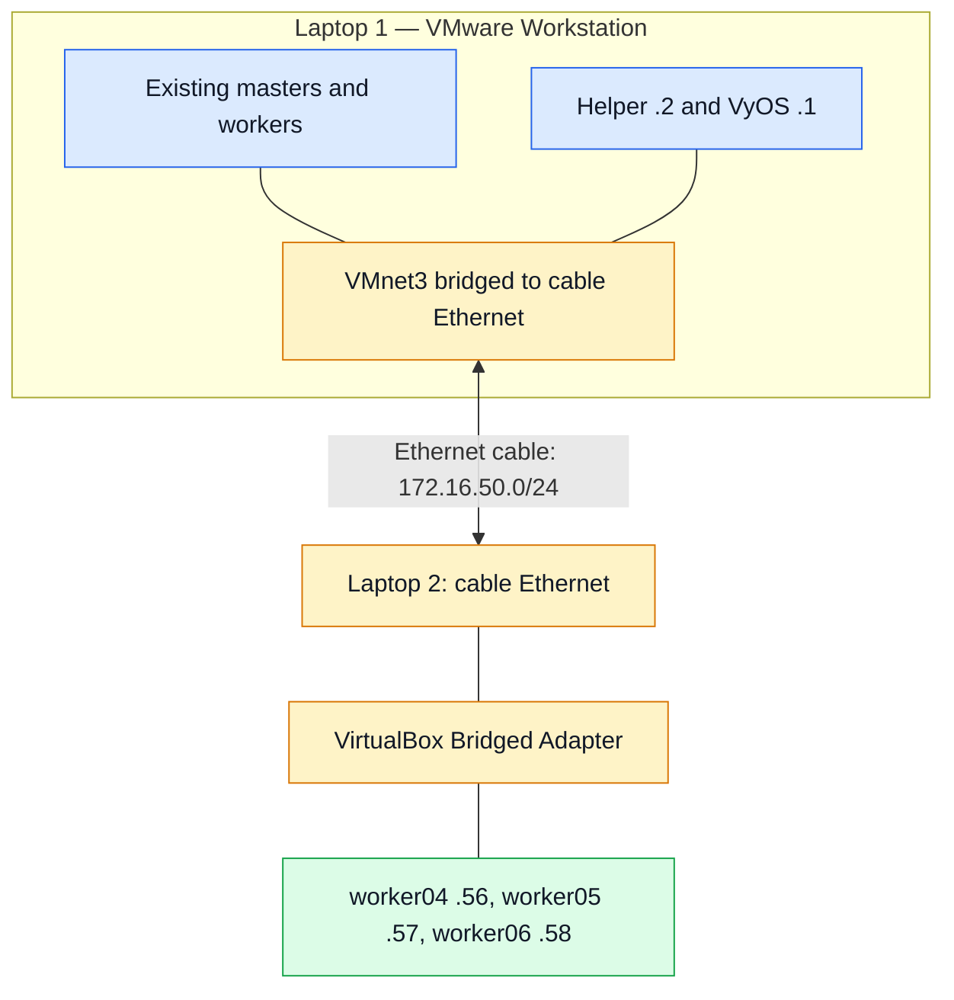

# Add three VirtualBox RHCOS workers to ocp.openhelp.net

Manual procedure for your two Windows laptops, connected directly by Ethernet. Laptop 1 runs the existing VMware Workstation cluster; laptop 2 runs Oracle VirtualBox. All cluster NICs share `172.16.50.0/24` through the cable. Wi-Fi connects the hosts to the home network.

These are instructions to run on your equipment; no changes have been made to your laptops or cluster from this chat.

## 1. Address and connection plan

| System | Address | Location / purpose |
| --- | --- | --- |
| VyOS eth1 | 172.16.50.1/24 | Existing gateway on laptop 1 |
| Helper ens224 | 172.16.50.2/24 | Existing Kea DHCP, DNS endpoint and NTP |
| Internal API/MCS VIP | 172.16.50.49 | Existing HAProxy listener |
| master01–master03 | 172.16.50.50–52 | Existing VMware VMs |
| worker01–worker03 | 172.16.50.53–55 | Existing VMware VMs |
| worker04.ocp.openhelp.net | **172.16.50.56/24** | New VirtualBox VM |
| worker05.ocp.openhelp.net | **172.16.50.57/24** | New VirtualBox VM |
| worker06.ocp.openhelp.net | **172.16.50.58/24** | New VirtualBox VM |

The last three addresses are proposed reservations. Confirm that they are unused before applying them. The VMs obtain their addresses automatically from Kea, including during the RHCOS live ISO session.



The VMware and VirtualBox network names need not match. Both hypervisors must attach the guest NICs to the physical Ethernet adapters at the two ends of this cable.

## 2. Check the existing cluster — run on helper

Use your working cluster-admin login. If necessary, select your existing kubeconfig:

```bash
export KUBECONFIG=/home/cloudadmin/ocp-lab/cluster/auth/kubeconfig
oc get clusterversion
oc get infrastructure cluster -o jsonpath='{.status.platformStatus.type}{"\n"}'
oc get nodes -o wide
oc get co
oc get mcp
```

This guide assumes the existing `platform: none` installation, which normally reports `None`. VMware Workstation does not mean the cluster uses the vSphere platform integration. If the platform reports `VSphere`, investigate that integration before using these mixed-hypervisor steps.

Resolve existing API or certificate failures before adding workers. Do not regenerate a new cluster installation configuration or rerun the bootstrap process to add capacity.

## 3. Connect the VMware network to the cable — laptop 1

1. Open **VMware Workstation → Edit → Virtual Network Editor → Change Settings**.
2. Select **VMnet3**, the existing `172.16.50.0/24` cluster network.
3. Set it to **Bridged**.
4. In **Bridged to**, explicitly choose the physical Ethernet or USB Ethernet adapter connected to laptop 2.
5. Apply the change. Applying virtual network changes can briefly interrupt cluster connectivity; make this change while the lab is idle, then check that the existing nodes remain reachable.
6. Select only VMnet3 for this change. Your uploaded screenshot shows VMnet0, VMnet1 and VMnet2 with other configurations; do not reconfigure those networks as part of extending VMnet3.
7. Check the following VM adapters:

| VMware guest adapter | Attach to |
| --- | --- |
| Helper adapter corresponding to ens224 | Custom: VMnet3 |
| VyOS adapter corresponding to eth1 | Custom: VMnet3 |
| Each existing master and worker cluster NIC | Custom: VMnet3 |
| Helper ens160 and VyOS eth0 management adapters | Their currently working management network |

Use the guest MAC addresses to identify adapters if their order is unclear. Verify the active cluster network before changing anything if your current editor differs from this plan.

Your screenshot shows **VMnet3: Host-only, 172.16.50.0, mask 255.255.255.0**, with VMware DHCP unchecked. The controls are grey because administrator privileges are required. Click the shield-marked **Change Settings** button at the bottom right, approve the Windows UAC prompt, and then reselect VMnet3 before choosing **Bridged**. Afterward, **Bridged to** must name the cable's physical adapter. It must not say Automatic. The subnet input can become unavailable in bridged mode; IP configuration still comes from Kea and the existing guests, so this is normal.

There must be only your intended Kea DHCP service on this cable segment. In a bridged VMnet, VMware's host-only DHCP controls may be unavailable; do not enable another DHCP service. No Windows Network Bridge or Internet Connection Sharing is part of this design.

On each Windows host, this command identifies the cable adapter:

```powershell
Get-NetAdapter | Format-Table Name,InterfaceDescription,Status,LinkSpeed
```

The cable adapter should report **Up**, preferably **1 Gbps**. The Windows adapter itself does not need a static `172.16.50.x` address for guest bridging to work. Leave host IP configuration automatic. A Windows “No Internet” label on the cable is not a VM connectivity test.

If Windows starts preferring the cable for host internet traffic, use the adapter's IPv4 **Advanced** settings to give the cable a higher interface metric than Wi-Fi, for example cable `5000`, Wi-Fi `10`. This changes host route preference, not guest DHCP.

## 4. Prepare installation files — helper

Use the cluster's current worker user-data and RHCOS boot-image metadata.

```bash
mkdir -p /home/cloudadmin/ocp-add-workers
cd /home/cloudadmin/ocp-add-workers

oc extract -n openshift-machine-api secret/worker-user-data-managed \
  --keys=userData --to=- > worker.ign

jq -e '.ignition.version' worker.ign
sha512sum worker.ign

oc -n openshift-machine-config-operator get configmap/coreos-bootimages \
  -o jsonpath='{.data.stream}' \
  | jq -r '.architectures.x86_64.artifacts.metal.formats.iso.disk.location'
```

The last command prints the ISO URL. Download that ISO using a connected machine and copy it to laptop 2, or reuse the compatible RHCOS ISO from the original worker installation. Do not choose a random latest RHCOS or Fedora CoreOS image. If the URL command returns `null`, inspect the cluster version and boot-image metadata before selecting an ISO.

If and only if `worker-user-data-managed` is **NotFound**, list the available worker secret names:

```bash
oc get secrets -n openshift-machine-api -o name | grep worker-user-data
```

If `secret/worker-user-data` exists, extract that instead and validate the result:

```bash
oc extract -n openshift-machine-api secret/worker-user-data \
  --keys=userData --to=- > worker.ign
jq -e '.ignition.version' worker.ign
sha512sum worker.ign
```

Stop if neither secret exists or extraction fails. An empty or invalid file must not be used for installation. The same valid worker Ignition file serves all three new workers.

For this operation, run a dedicated HTTP server on helper port **8081**. Keep this terminal open until all three installations have fetched their configuration:

```bash
python3 -m http.server 8081 --bind 172.16.50.2 \
  --directory /home/cloudadmin/ocp-add-workers
```

In another helper terminal:

```bash
curl --noproxy '*' -fsS http://172.16.50.2:8081/worker.ign \
  -o /tmp/worker-http-check.ign
cmp /home/cloudadmin/ocp-add-workers/worker.ign /tmp/worker-http-check.ign
```

`cmp` should produce no output and return success. Port `8081` is just this HTTP file-delivery endpoint; the existing API/MCS ports remain the same.

If firewalld is active, inspect its zones:

```bash
sudo firewall-cmd --get-active-zones
```

Open `8081/tcp` in the zone containing **ens224**. Example for a zone named `public`:

```bash
sudo firewall-cmd --zone=public --add-port=8081/tcp
```

Use the actual ens224 zone in that command. This temporary rule is sufficient for the installation session. Do not disable the firewall.

## 5. Create the three VMs — laptop 2, VirtualBox

Create each VM separately with its own empty virtual disk and identity. Select **Skip Unattended Installation** when available.

| Setting | Value |
| --- | --- |
| VM names | worker04, worker05, worker06 |
| OS type | Linux, Red Hat 64-bit / compatible 64-bit Linux profile |
| CPU | At least 2 vCPU each; 4 if the host has sufficient capacity |
| RAM | At least 8192 MB each |
| OS disk | 120 GB VDI, SATA controller, SSD-backed storage preferred |
| Optical drive | Attach the RHCOS x86_64 live ISO |
| Adapter 1 attachment | **Bridged Adapter** / **Bridged Network** |
| Adapter 1 name | **Physical Ethernet/USB Ethernet connected to laptop 1** |
| Adapter type | Intel PRO/1000 MT Desktop (82540EM), or supported virtio-net |
| Cable Connected | Checked |
| Promiscuous mode | Default Deny is sufficient for ordinary OpenShift worker networking |
| Adapters 2–4 | Disabled |

The three VMs need at least **24 GB guest RAM** in total. A **32 GB Windows host** is a practical minimum for this plan, leaving approximately 8 GB for Windows and other overhead; it does not guarantee adequate CPU or disk performance. OpenShift's published compute minimum is 2 vCPU, 8 GB RAM and 100 GB storage per node. Use more resources for workloads.

Ensure hardware virtualization is enabled in the laptop BIOS/UEFI. Nested virtualization inside the worker is a separate requirement for running KubeVirt guests later; it is not needed for an ordinary container worker.

Set these deliberate, unique MAC addresses under **Network → Advanced** before booting:

| VM | Enter in VirtualBox, without colons | Matching Kea MAC |
| --- | --- | --- |
| worker04 | `080027165056` | `08:00:27:16:50:56` |
| worker05 | `080027165057` | `08:00:27:16:50:57` |
| worker06 | `080027165058` | `08:00:27:16:50:58` |

These are MACs you are assigning, not values read from your laptop. Confirm they are unique in your lab. If you keep VirtualBox-generated MACs, substitute those actual values in Kea instead. Reserve guest MACs, not the Windows Ethernet adapter's MAC.

Do not clone an already installed RHCOS worker disk. Its node identity and credentials would also be copied.

## 6. Add Kea reservations — helper

First check the active configuration path and current allocation information:

```bash
sudo systemctl cat kea-dhcp4
sudo grep -nE '172\.16\.50\.(56|57|58)|08:00:27:16:50:(56|57|58)' \
  /etc/kea/kea-dhcp4.conf
sudo grep -nE '^172\.16\.50\.(56|57|58),' /var/lib/kea/kea-leases4.csv
```

The lease-file check applies when Kea uses its usual CSV memfile backend. If the service uses another file or database, inspect that active configuration/lease source instead. Also check `oc get nodes -o wide` and your address inventory. A failed ping alone does not prove an address is free. Resolve any existing address or MAC assignment before proceeding.

Back up the configuration and edit it manually:

```bash
sudo cp -a /etc/kea/kea-dhcp4.conf \
  /etc/kea/kea-dhcp4.conf.before-worker04-06
sudo vi /etc/kea/kea-dhcp4.conf
```

Inside the existing `172.16.50.0/24` subnet's **reservations array**, append these three objects. Keep every existing reservation. Add the comma separating the previous last object from the first new one. This is a fragment for the existing array, not a replacement configuration file:

```json
{
  "hw-address": "08:00:27:16:50:56",
  "ip-address": "172.16.50.56",
  "hostname": "worker04.ocp.openhelp.net",
  "option-data": [
    { "name": "host-name", "data": "worker04.ocp.openhelp.net", "always-send": true }
  ]
},
{
  "hw-address": "08:00:27:16:50:57",
  "ip-address": "172.16.50.57",
  "hostname": "worker05.ocp.openhelp.net",
  "option-data": [
    { "name": "host-name", "data": "worker05.ocp.openhelp.net", "always-send": true }
  ]
},
{
  "hw-address": "08:00:27:16:50:58",
  "ip-address": "172.16.50.58",
  "hostname": "worker06.ocp.openhelp.net",
  "option-data": [
    { "name": "host-name", "data": "worker06.ocp.openhelp.net", "always-send": true }
  ]
}
```

Keep the existing subnet options: router `172.16.50.1`, DNS `172.16.50.2`, domain `ocp.openhelp.net` and NTP `172.16.50.2`. Keep DHCP listening on the helper cluster interface `ens224`. Confirm subnet reservations are enabled; do not use `reservations-out-of-pool: true` if any reserved addresses belong to the dynamic pool.

Validate first:

```bash
sudo kea-dhcp4 -t /etc/kea/kea-dhcp4.conf
```

Only after a successful test:

```bash
sudo systemctl restart kea-dhcp4
sudo systemctl status kea-dhcp4 --no-pager
```

Use the configuration path shown by the service if it differs. Do not start another DHCP server on laptop 2. Kea's broadcasts and replies cross the Ethernet bridge directly; DHCP relay is unnecessary on this shared subnet.

## 7. Add DNS A and PTR records — FreeIPA

Run from the FreeIPA server or an enrolled admin host with the `ipa` CLI:

```bash
kinit admin
ipa dnszone-find
```

Choose the existing authoritative forward zone. The following commands assume it is **openhelp.net.**, so each relative name includes `.ocp`:

```bash
ipa dnsrecord-add openhelp.net. worker04.ocp --a-rec=172.16.50.56
ipa dnsrecord-add openhelp.net. worker05.ocp --a-rec=172.16.50.57
ipa dnsrecord-add openhelp.net. worker06.ocp --a-rec=172.16.50.58
```

If the existing authoritative zone is instead **ocp.openhelp.net.**, use these commands instead of the previous three:

```bash
ipa dnsrecord-add ocp.openhelp.net. worker04 --a-rec=172.16.50.56
ipa dnsrecord-add ocp.openhelp.net. worker05 --a-rec=172.16.50.57
ipa dnsrecord-add ocp.openhelp.net. worker06 --a-rec=172.16.50.58
```

Check the reverse zone:

```bash
ipa dnszone-show 50.16.172.in-addr.arpa.
```

If no DNS server already manages this subnet's reverse zone, and it is missing in FreeIPA, create it once:

```bash
ipa dnszone-add 50.16.172.in-addr.arpa.
```

Add the PTR records to that zone:

```bash
ipa dnsrecord-add 50.16.172.in-addr.arpa. 56 --ptr-rec=worker04.ocp.openhelp.net.
ipa dnsrecord-add 50.16.172.in-addr.arpa. 57 --ptr-rec=worker05.ocp.openhelp.net.
ipa dnsrecord-add 50.16.172.in-addr.arpa. 58 --ptr-rec=worker06.ocp.openhelp.net.
```

If a record exists, inspect it and correct only a conflicting value instead of adding duplicate addresses.

On helper, verify through the DNS endpoint the workers will actually use:

```bash
dig @172.16.50.2 +short worker04.ocp.openhelp.net
dig @172.16.50.2 +short worker05.ocp.openhelp.net
dig @172.16.50.2 +short worker06.ocp.openhelp.net
dig @172.16.50.2 +short -x 172.16.50.56
dig @172.16.50.2 +short -x 172.16.50.57
dig @172.16.50.2 +short -x 172.16.50.58
dig @172.16.50.2 +short api-int.ocp.openhelp.net
dig @172.16.50.2 +short api.ocp.openhelp.net
```

Expected new forward answers are `.56`, `.57`, `.58`; reverse answers must match their FQDNs. The internal API should resolve to the internal VIP `172.16.50.49` for this design. If multiple addresses are returned, every address used for MCS access must accept port `22623`; an external VIP without that listener can cause intermittent installation failures. Ensure helper DNS forwards the new forward and reverse records to their authority.

## 8. Boot and test worker04 before installing — its VirtualBox console

Start only **worker04** initially. Let the RHCOS live ISO reach its shell.

```bash
ip -br link
ip -br address
ip route
nmcli device show
cat /etc/resolv.conf
date -u
```

Confirm the VM MAC matches `.56`'s reservation. Typical VirtualBox NIC naming is `enp0s3`, but use the actual interface name. Expected values:

| Item | Expected |
| --- | --- |
| IPv4 | 172.16.50.56/24 |
| Default route | via 172.16.50.1 |
| DNS | 172.16.50.2, or a local resolver forwarding there |
| Time | Correct current UTC time |

If DHCP has not yet succeeded, inspect the connection and reconnect the real interface:

```bash
nmcli device status
sudo nmcli device connect enp0s3
```

Replace `enp0s3` if necessary. Keep automatic addressing; diagnose the bridge and Kea before installing.

Run these network checks from the VM:

```bash
ping -c 3 172.16.50.2
ping -c 3 172.16.50.1
ping -c 3 172.16.50.50

getent ahostsv4 api-int.ocp.openhelp.net
getent ahostsv4 api.ocp.openhelp.net
getent hosts worker04.ocp.openhelp.net

curl --noproxy '*' -fsS --connect-timeout 5 --max-time 20 \
  http://172.16.50.2:8081/worker.ign -o /tmp/worker.ign

sha512sum /tmp/worker.ign

curl --noproxy '*' -ksS --connect-timeout 5 --max-time 20 \
  -o /dev/null -w 'MCS HTTP %{http_code}\n' \
  https://api-int.ocp.openhelp.net:22623/config/worker

curl --noproxy '*' -ksS --connect-timeout 5 --max-time 20 \
  -o /dev/null -w 'API HTTP %{http_code}\n' \
  https://api.ocp.openhelp.net:6443/readyz
```

Expected MCS result is **HTTP 200**; a healthy API readiness endpoint normally returns **200**. An API authentication response such as `401` or `403` shows connectivity but is not a successful readiness check. `HTTP 000`, connection refusal, name-resolution failure or timeout must be investigated before installation. These `-k` requests are connectivity diagnostics; installed Ignition must still validate the cluster CA.

Compare the VM's worker file SHA512 digest with the value printed on helper. They must match.

The installed node also needs the same image-registry access or configured registry mirror as existing workers. `--offline` below avoids downloading the OS during the disk-install step; it does not make subsequent OpenShift image pulls unnecessary. Check NTP reachability to helper if the clock is wrong; do not work around certificate errors by setting an incorrect date.

## 9. Install worker04 — its VirtualBox live console

Identify the new VM's OS disk:

```bash
lsblk -o NAME,SIZE,TYPE,MODEL
```

For the SATA VDI configured above, it will normally be `/dev/sda`. The installation command **overwrites that virtual disk**. Run it only in the new VM after checking the disk:

```bash
sudo coreos-installer install /dev/sda \
  --offline \
  --copy-network \
  --ignition-url=http://172.16.50.2:8081/worker.ign \
  --ignition-hash=sha512-PASTE_THE_HELPER_SHA512_DIGEST_HERE
```

Replace the entire `PASTE_THE_HELPER_SHA512_DIGEST_HERE` text with the hex digest from helper, retaining `sha512-`. Use that same confirmed digest for each VM. If the disk has a different device name, change only the device argument accordingly. `--copy-network` copies NetworkManager keyfiles; keep the DHCP reservation in Kea for persistence. If the live DHCP keyfile is under `/run/NetworkManager/system-connections` instead of the default copy directory, inspect that situation before relying on the flag; a single-NIC installed system can also obtain its reserved address through automatic DHCP.

When installation reports success, eject the ISO from the VirtualBox optical drive and reboot:

```bash
sudo reboot
```

Let the VM boot from the VDI. Its first boot might apply the cluster OS configuration and reboot again.

## 10. Approve worker04 certificate requests — helper

```bash
oc get csr
```

For a pending request, substitute its actual name below:

```bash
CSR=csr-REPLACE_ME
oc get csr "$CSR" -o jsonpath='{.spec.signerName}{"\n"}{.spec.username}{"\n"}'
oc get csr "$CSR" -o jsonpath='{.spec.request}' \
  | base64 -d | openssl req -noout -text
```

Verify identity before approving:

| Request | Expected identity |
| --- | --- |
| Kubelet client CSR | Signer `kubernetes.io/kube-apiserver-client-kubelet`; subject `CN=system:node:worker04.ocp.openhelp.net`, organization `system:nodes`; initial requester normally the node-bootstrapper service account |
| Kubelet serving CSR | Signer `kubernetes.io/kubelet-serving`; requester/subject belongs to worker04; requested DNS/IP SANs match worker04 and 172.16.50.56 |

Approve the verified client request:

```bash
oc adm certificate approve "$CSR"
oc get csr
```

After the client certificate is issued, inspect and approve worker04's serving CSR the same way, setting `CSR` to that new request's name. Approve current valid requests promptly; retries can generate additional requests. Do not approve unrelated pending CSRs in bulk.

Check the node:

```bash
oc get nodes -o wide
oc describe node worker04.ocp.openhelp.net
```

Proceed after worker04 becomes **Ready**. Unexpected names such as `localhost` or a MAC-based hostname should be corrected in DHCP/DNS and reprovisioned before continuing with the other workers; do not approve an identity you cannot match.

## 11. Repeat for worker05 and worker06

Repeat steps 8–10, first for worker05 and then worker06. Use the same ISO, worker Ignition URL and confirmed hash, but check each VM's unique MAC, address and CSR identity:

| VM | Address | Expected node identity |
| --- | --- | --- |
| worker05 | 172.16.50.57 | worker05.ocp.openhelp.net |
| worker06 | 172.16.50.58 | worker06.ocp.openhelp.net |

## 12. Extend HAProxy ingress targets — helper

New workers may host ingress-router pods. Add them to the existing HAProxy ingress backends so application routes can follow router placement. Keep all existing targets.

```bash
sudo cp -a /etc/haproxy/haproxy.cfg \
  /etc/haproxy/haproxy.cfg.before-worker04-06
sudo vi /etc/haproxy/haproxy.cfg
```

Append these entries inside the existing HTTP ingress backend that serves port 80:

```haproxy
server worker04 172.16.50.56:80 check
server worker05 172.16.50.57:80 check
server worker06 172.16.50.58:80 check
```

Append these inside the corresponding HTTPS ingress backend that serves port 443:

```haproxy
server worker04 172.16.50.56:443 check
server worker05 172.16.50.57:443 check
server worker06 172.16.50.58:443 check
```

If ingress placement is deliberately restricted to the old workers, these extra targets are unnecessary while that restriction remains in place. A health check is expected to be DOWN on a worker with no router listening. Workers are not API/MCS backends: the `6443` and `22623` backends continue to target the control-plane nodes.

Validate before reloading:

```bash
sudo haproxy -c -f /etc/haproxy/haproxy.cfg
```

Only when validation succeeds:

```bash
sudo systemctl reload haproxy
oc -n openshift-ingress get pods -o wide
```

## 13. Final verification — helper and console

```bash
oc get nodes -o wide
oc get nodes -l node-role.kubernetes.io/worker
oc get mcp worker
oc get co
oc get pods -n openshift-ovn-kubernetes -o wide
oc get pods -A -o wide --field-selector spec.nodeName=worker04.ocp.openhelp.net
oc get pods -A -o wide --field-selector spec.nodeName=worker05.ocp.openhelp.net
oc get pods -A -o wide --field-selector spec.nodeName=worker06.ocp.openhelp.net
```

Expected result, if the previous six nodes are still present: **9 nodes total: 3 masters and 6 workers**. All new workers should report `Ready`, and the worker MachineConfigPool should eventually be updated and not degraded. Check that no new operator degradation remains.

In the OpenShift web console, use **Administrator → Compute → Nodes** to see the new workers. OpenShift manages these RHCOS nodes and their workloads; VM creation, power and virtual hardware remain managed through VirtualBox.

If the worker Ignition configuration includes your existing SSH public key, log in from helper with:

```bash
ssh -i /home/cloudadmin/.ssh/ocp_ed25519 core@172.16.50.56
ssh -i /home/cloudadmin/.ssh/ocp_ed25519 core@172.16.50.57
ssh -i /home/cloudadmin/.ssh/ocp_ed25519 core@172.16.50.58
```

After all three nodes have fetched Ignition and joined successfully, stop the temporary Python HTTP server with Ctrl+C. If you added the temporary firewalld rule and it is no longer needed, remove it from the same zone:

```bash
sudo firewall-cmd --zone=public --remove-port=8081/tcp
```

## 14. Connectivity checks and troubleshooting

Because the new nodes are on the existing `172.16.50.0/24` Layer 2 network, their traffic to helper and other nodes crosses the cable directly. No additional VyOS VM, subnet route or DHCP relay is needed. The existing SNAT rule for the whole `172.16.50.0/24` network covers new workers' off-subnet traffic; any per-address firewall allowlists must also admit their addresses.

Important flows for this design:

| Source / destination | Protocol / port | Purpose |
| --- | --- | --- |
| VM DHCP client ↔ helper | UDP 68 ↔ 67 | Automatic network configuration |
| Workers → helper .2 | TCP/UDP 53 | DNS |
| Workers → helper .2 | UDP 123 | NTP |
| Workers → helper .2 | TCP 8081 | Temporary worker Ignition download |
| Workers → api/api-int VIP | TCP 6443 | Kubernetes API |
| Workers → api-int VIP | TCP 22623 | Machine Config Server |
| Existing/new nodes ↔ each other | UDP 6081 | OVN Geneve overlay |
| Existing/new nodes ↔ each other | TCP 10250–10259 | Kubernetes-reserved node services |
| Existing/new nodes ↔ each other | TCP/UDP 9000–9999; TCP 1936 | Host services and metrics |
| Nodes used for NodePort services | TCP/UDP 30000–32767 | NodePort, when used |
| Helper/load balancer → ingress targets | TCP 80/443 | Application ingress |
| Workers → image registries/mirror | Usually TCP 443 | OS and container image pulls |

Additional flows apply if you enabled features such as OVN IPsec. Preserve the existing cluster's network policy requirements. A successful ping does not prove UDP Geneve traffic works. Do not globally disable Windows security; inspect bridge-driver bindings and any filtering relevant to the cable.

**No DHCP address:** on helper, capture requests while starting the new VM:

```bash
sudo tcpdump -eni ens224 'udp port 67 or udp port 68'
sudo journalctl -u kea-dhcp4 -n 80 --no-pager
```

- No DHCPDISCOVER arriving: check the physical link, VirtualBox physical adapter selection, MAC, Cable Connected, and the VMware VMnet3 bridge binding.
- DISCOVER arrives without an offer: check Kea subnet, reservation, allocation, active interface and logs.
- Offer leaves helper but VM never gets it: investigate bridge-driver/adapter filtering and conflicting DHCP services.

**Wrong subnet:** `10.0.2.x` usually indicates VirtualBox NAT; `192.168.56.x` often indicates VirtualBox host-only networking; `192.168.0.x` suggests the home Wi-Fi/LAN rather than the cable network. Select the cable's bridged adapter and retry DHCP.

**Ignition fails:** verify the HTTP URL, exact SHA512 digest, DNS, MCS port, current time and that the worker file was extracted from this cluster. On the installed VM console inspect:

```bash
sudo journalctl -b -u ignition-fetch.service --no-pager
sudo journalctl -b -u ignition-complete.service --no-pager
sudo journalctl -b -u kubelet -n 100 --no-pager
sudo journalctl -b -u crio -n 100 --no-pager
```

Unit availability differs by boot stage. On helper also check `oc get csr`.

**Node joins but remains NotReady:** inspect `oc describe node`, pending CSRs, the worker MachineConfigPool and OVN pods on that node. Check image pulls, free disk space and UDP 6081 across the physical cable.

**Applications stop responding after routers move:** check router pod placement and HAProxy's ingress target list from step 12.

## Official references

- [VMware Workstation Virtual Network Editor](https://knowledge.broadcom.com/external/article/339371/using-the-virtual-network-editor-in-vmwa.html)
- [Oracle VirtualBox networking](https://docs.oracle.com/en/virtualization/virtualbox/7.2/user/networkingdetails.html)
- [Oracle VirtualBox VM creation](https://docs.oracle.com/en/virtualization/virtualbox/7.2/user/create-vm.html)
- [Red Hat: manually adding compute nodes to user-provisioned infrastructure](https://docs.redhat.com/en/documentation/openshift_container_platform/4.22/html/machine_management/managing-user-provisioned-infrastructure-manually)
- [Red Hat: platform-agnostic hardware and network requirements](https://docs.redhat.com/en/documentation/openshift_container_platform/4.22/html/installing_on_any_platform/installing-platform-agnostic)
- [CoreOS Installer options](https://coreos.github.io/coreos-installer/cmd/install/)
- [ISC Kea DHCPv4 reservations and validation](https://kea.readthedocs.io/en/latest/arm/dhcp4-srv.html)
- [FreeIPA DNS record API](https://freeipa.readthedocs.io/en/latest/api/dnsrecord_add.html)

Use the release returned by `oc get clusterversion` when choosing version-specific installation material. The cluster's own worker user-data and boot-image metadata are the primary inputs for this procedure.
